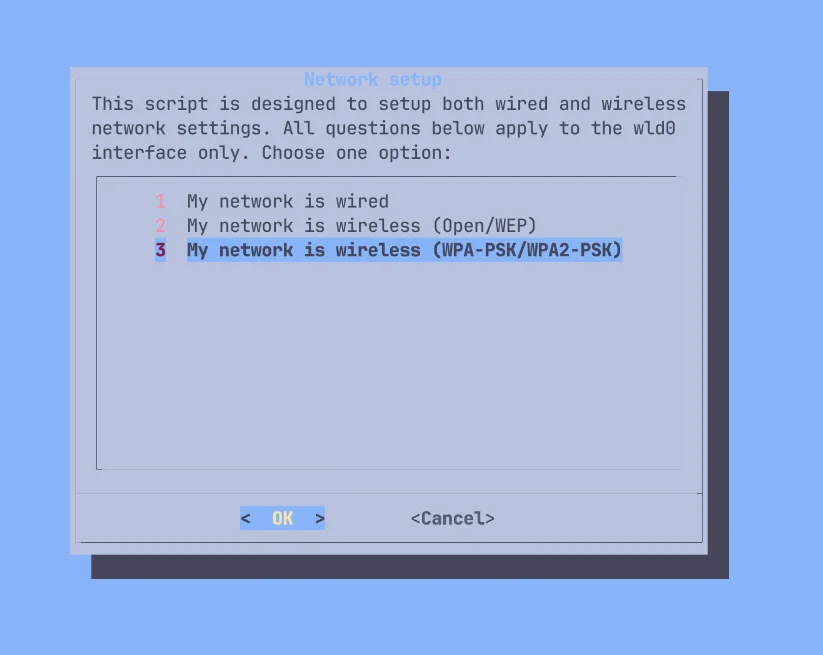
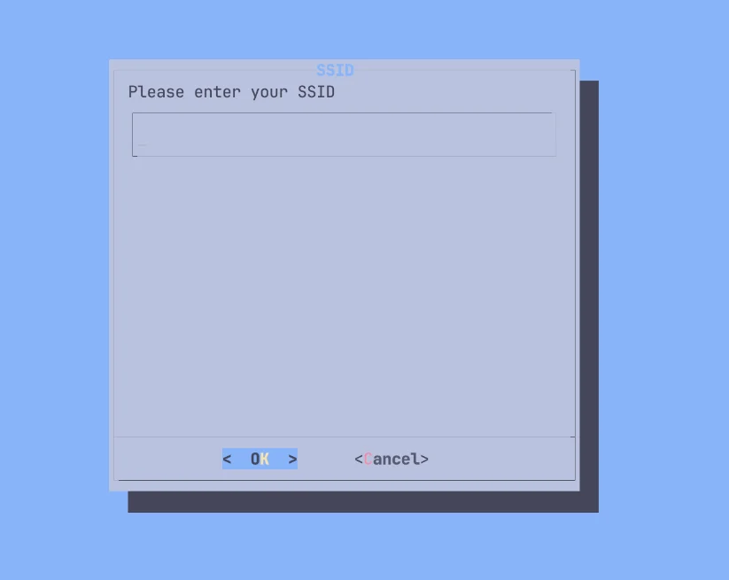

**Updated 2026-10-26**: rewritten from a real install on a MacBook Air M2, adding official binpkgs and a tested LUKS setup.

Install ARM64 Gentoo alongside macOS on supported M1/M2 Macs. Use systemd for Gentoo; the OpenRC commands apply only to the live USB.

Installation guide: <https://wiki.gentoo.org/wiki/Project:Asahi/Guide>

Check model support before partitioning. M2 Mac Pro installer support is WIP; later generations are outside this guide.

M1 support: <https://asahilinux.org/docs/platform/feature-support/m1/>

M2 support: <https://asahilinux.org/docs/platform/feature-support/m2/>

All generations: <https://asahilinux.org/docs/platform/feature-support/overview/>

## Process Overview

1. Download the Gentoo Asahi live USB image
2. Set up U-Boot via the Asahi installer
3. Boot from the live USB
4. Partition and mount the filesystem
5. Extract the Stage3 and chroot
6. Install the Asahi support package set
7. Reboot to finish the install

Optional steps: LUKS encryption, a custom kernel, PipeWire audio, a desktop environment.

## Prerequisites

### Hardware Requirements

- An M1/M2 Mac supported by the Asahi installer
- At least 80 GB of free disk space, 120 GB or more is better
- Stable Wi-Fi or Ethernet

### Known Working Status

CPU, storage, Wi-Fi, laptop keyboards and trackpads, and GPU acceleration work on supported models. Display and audio support vary by model. Thunderbolt and USB-C DisplayPort Alt Mode are marked WIP; Touch ID is unsupported.

macOS virtualization is not supported.

## 1. Prepare the Gentoo Asahi Live USB

### 1.1 Download the Image

Download the ISO and its `.sha256`, then check it:

- <https://chadmed.au/pub/gentoo/install-arm64-asahi-20260827.iso>
- <https://chadmed.au/pub/gentoo/install-arm64-asahi-20260827.iso.sha256>

```bash
$ shasum -a 256 -c install-arm64-asahi-20260827.iso.sha256
```

Write the USB only after it prints `OK`.

The 20260827 image has been verified to boot on a MacBook Air M2. The 20261006 image ships GRUB 2.16, which fails on Asahi U-Boot with `cannot allocate memory for memory map`; do not use it for now.

### 1.2 Create the Bootable USB

In the download directory, identify the USB with `diskutil list`; replace `/dev/disk4`. Writing erases the USB:

```bash
$ diskutil list
$ diskutil unmountDisk /dev/disk4
$ sudo dd if=install-arm64-asahi-20260827.iso of=/dev/rdisk4 bs=4m
$ diskutil eject /dev/disk4
```

## 2. Set Up the Asahi U-Boot Environment

### 2.1 Run the Asahi Installer

Details: <https://alx.sh>

Open Terminal in macOS and run:

```bash
$ curl https://alx.sh | sh
```

Enter the sudo password after bootstrapping, then press Enter at `Press enter to continue`.

Output from a MacBook Air (M2, 2022):

```text
Collecting system information...
  Product name: MacBook Air (M2, 2022)
  SoC: Apple M2
  Device class: j413ap
  Product type: Mac14,2
  Board ID: 0x28
  Chip ID: 0x8112
  System firmware: mBoot-20457.1.29
  Boot UUID: 0396B26F-E9D1-47A3-AC3C-6D26CC3F2F64
  Boot VGID: 0396B26F-E9D1-47A3-AC3C-6D26CC3F2F64
  Default boot VGID: 0396B26F-E9D1-47A3-AC3C-6D26CC3F2F64
  Boot mode: macOS
  OS version: 27.0.1 (26A434)
  OS restore version: 26.1.434.0.0,0
  Main firmware version: 27.0.1 (26A434)
  No Fallback System Firmware / rOS
  SFR version: 26.1.434.0.0,0
  SystemRecovery version: 25.7.83.0.0,0 (26.6.2 25G83)
  Login user: zakk
```

### 2.2 Follow the Installer

1. Enter `r` to shrink macOS, or `f` if enough unallocated space exists (skip to step 5).

   ```text
   Partitions in system disk (disk0):
     1: APFS [Macintosh HD] (494.38 GB, 6 volumes)
       OS: [B*] [Macintosh HD] macOS v27.0.1 [disk3s3s1, 0396B26F-E9D1-47A3-AC3C-6D26CC3F2F64]
     2: APFS (System Recovery) (5.37 GB, 2 volumes)
       OS: [  ] recoveryOS v27.0.1 [Primary recoveryOS]

     [B ] = Booted OS, [R ] = Booted recovery, [? ] = Unknown
     [ *] = Default boot volume

   Using OS 'Macintosh HD' (disk3s3s1) for machine authentication.

   Choose what to do:
     r: Resize an existing partition to make space for a new OS
     q: Quit without doing anything
   » Action (r): r
   ```

2. Enter the size macOS keeps after shrinking; the rest is left for Gentoo.

   ```text
   We're going to resize this partition:
     APFS [Macintosh HD] (494.38 GB, 6 volumes)
     Total size: 494.38 GB
     Free space: 244.98 GB
     Available space: 206.98 GB
     Overhead: 0 B
     Minimum new size: 287.41 GB (58.13%)

   Enter the new size for your existing partition:
     You can enter a size such as '1GB', a fraction such as '50%',
     or the word 'min' for the smallest allowable size.

     Examples:
     30%  - 30% to macOS, 70% to the new OS
     80GB - 80GB to macOS, the rest to your new OS
     min  - Shrink macOS as much as (safely) possible

   » New size (min): 366GB
   ```

   `80GB` keeps 80 GB for macOS; `30%` keeps 30% and frees 70%; `min` uses the smallest safe size. Leave at least 80 GB for Gentoo. The minimum depends on used space; if rejected, enter a larger value or `min`.

   ```text
   Size is too small, please enter a value > 287.41 GB
   ```

3. Check the space to be freed, then enter `y` at `Continue?`.

   ```text
   Resizing will free up 128.38 GB of space.

   Note: your system may appear to freeze during the resize.
   This is normal, just wait until the process completes.
   » Continue? (y/N): y
   ```

   At `Resize complete`, press Enter to return to the menu. If the resize fails, fix the error before partitioning.

   ```text
   Finished APFS operation
   Resize complete. Press enter to continue.
   ```

4. Check the newly freed space:

   ```text
   Partitions in system disk (disk0):
     1: APFS [Macintosh HD] (366.00 GB, 6 volumes)
       OS: [B*] [Macintosh HD] macOS v27.0.1 [disk3s3s1, 0396B26F-E9D1-47A3-AC3C-6D26CC3F2F64]
     2: (free space: 128.38 GB)
     3: APFS (System Recovery) (5.37 GB, 2 volumes)
       OS: [  ] recoveryOS v27.0.1 [Primary recoveryOS]
   ```

   Enter `f` at the action menu.

   ```text
   Choose what to do:
     f: Install an OS into free space
     r: Resize an existing partition to make space for a new OS
     q: Quit without doing anything
   » Action (f): f
   ```

5. Choose `UEFI environment only (m1n1 + U-Boot + ESP)`, not Fedora Asahi Remix. Use its displayed number, not a fixed `5`.

   ```text
   Choose an OS to install:
     1: Fedora Asahi Remix 44 with KDE Plasma
     2: Fedora Asahi Remix 44 with GNOME
     3: Fedora Asahi Remix 44 Server
     4: Fedora Asahi Remix 44 Minimal
     5: UEFI environment only (m1n1 + U-Boot + ESP)
   » OS: 5
   ```

   Enter any name; the startup volume list shows it. This guide uses `Gentoo Linux`.

   ```text
   Minimum required space for this OS: 3.00 GB

   Available free space: 128.38 GB

   Enter a name for your OS
   » OS name (UEFI boot): Gentoo Linux
   ```

6. Wait for the stub macOS and roughly 500 MB EFI partition to be created.

   ```text
   Creating new stub macOS named Gentoo Linux
   ```

   Re-enter the macOS administrator password; the new OS becomes the default boot volume.

   ```text
   To continue the installation, you will need to enter your macOS
   admin credentials.
   Password for zakk:
   ```

7. After `Installation successful!`, choose `y` to send the anonymous report, `n` to decline, or `d` to inspect it.

   ```text
   Installation successful!
   ```

   ```text
   Help us improve Asahi Linux!
   We'd love to know how many people are installing Asahi and on what
   kind of hardware. Would you mind sending a one-time installation
   report to us?

   This will only report what kind of machine you have, the OS you're
   installing, basic version info, and the rough install size.
   No personally identifiable information (such as serial numbers,
   specific partition sizes, etc.) is included. You can view the
   exact data that will be sent.

   Report your install?
     y: Yes
     n: No
     d: View the data that will be sent
   » Choice (y/n/d):
   ```

### 2.3 Complete the Recovery Setup

Press Enter to view the final instructions, then Enter at the shutdown prompt:

```text
Press enter to shut down the system.
```

1. Wait 25 seconds for the system to shut down fully.
2. Press and hold the power button once; do not press it repeatedly. The text below the Apple logo changes while you hold it:

   | Screen text | Action |
   | --- | --- |
   | `Continue holding for startup options...` | Keep holding |
   | `Loading startup options...` | Release the button |

3. Wait for the volume list: `Macintosh HD`, `Gentoo Linux` (Asahi icon) and `Options`.
4. Select `Gentoo Linux` and click `Continue`.

   

5. `macOS Recovery` appears briefly. At `Select a volume to recover`, choose your normal macOS volume, click `Next`, and enter your macOS credentials if asked.
6. When the `Asahi Linux installer` screen appears, Terminal runs the second step, `step2.sh`, on its own. It changes the security level of the Gentoo install only; macOS is not affected. You enter your macOS credentials twice.

   Press Enter to continue:

   ```text
   -bash-3.2# /Volumes/Gentoo\ Linux/Finish\ Installation.app/Contents/Resources/step2.sh ; exit;

   Asahi Linux installer (second step)

   VGID: 053D3C79-831B-4D09-9D75-199B5AA0924B
   System volume: /Volumes/Gentoo Linux

   You will see some messages advising you that you are changing the
   security level of your system. These changes apply only to your
   Asahi Linux install, and are necessary to install a third-party OS.

   Apple Silicon platforms maintain a separate security level for each
   installed OS, and are designed to retain their security with mixed OSes.
   The security level of your macOS install will not be affected.

   You will be prompted for login credentials two times.
   Please enter your macOS credentials (for the macOS that you
   used to run the first step of the installation).

   Press enter to continue.
   ```

   Enter your macOS password:

   ```text
   Operating on Volume Group UUID 053D3C79-831B-4D09-9D75-199B5AA0924B

   This utility is not meant for normal users or even sysadmins.
   It provides unabstracted access to capabilities which are normally handled for the user automatically when changing the security policy through GUIs such as the Startup Security Utility in macOS Recovery ("recoveryOS").
   It is possible to make your system security much weaker and therefore easier to compromise using this tool.
   This tool is not to be used in production environments.
   It is possible to render your system unbootable with this tool.
   It should only be used to understand how the security of Apple Silicon Macs works.
   Use at your own risk!

   Please enter password for user zakk:
   ```

   The installer updates the local policy and prints it. `Security Mode` becomes `Permissive`, for Gentoo only:

   ```text
   Local policy update is in progress, please wait...

   Resulting local policy:
   (chip ID and hashes omitted)
   Security Mode:               Permissive (smb0 && smb1): 1
   3rd Party Kexts Status:      Disabled   (smb2): absent
   User-allowed MDM Control:    Disabled   (smb3): absent
   DEP-allowed MDM Control:     Disabled   (smb4): absent
   SIP Status:                  Enabled    (sip0): absent
   Signed System Volume Status: Enabled    (sip1): absent
   Kernel CTRR Status:          Disabled   (sip2): 1
   Boot Args Filtering Status:  Enabled    (sip3): absent
   ```

   Enter `y` to confirm:

   ```text
   By setting a custom boot object, you will be putting your system into Permissive Security.

   Are you sure you want to do this? (enter y or n) y
   found raw boot object, deriving Mach-O boot properties...
   wrapping boot object payload...
   going to change bootpolicy to permissive...
   updating local machine policy...
   ```

   Enter your macOS user name and password again:

   ```text
   Username: zakk
   Password:
   installing boot object...
   done.

   Wrapping up...
   ```

   Press Enter to reboot:

   ```text
   Installation complete! Press enter to reboot.
   ```

A boot loop or macOS reinstall message means the startup sequence was missed. **Shut down fully:** wait the full 25 seconds with the screen dark, then press and hold the power button once.

Only if that retry still fails, boot macOS, rerun `curl https://alx.sh | sh`, and choose `p` as a last resort.

## 3. Boot from the Live USB

Insert the USB and power on; U-Boot boots its GRUB automatically. To select it manually:

```
setenv boot_targets "usb"
setenv bootmeths "efi"
boot
```

### 3.1 Connect to Wi-Fi

The live USB has no NetworkManager; set up Wi-Fi with `net-setup`:

```bash
# net-setup
```

1. Select the wireless interface `wld0`.

   

2. At `Interface details`, confirm with `Yes`.
3. Choose the network type:
   - `1`: wired network
   - `2`: Wi-Fi with no password or WEP
   - `3`: Wi-Fi with a password (WPA/WPA2); choose this for a typical home network

   

4. Enter the Wi-Fi name (SSID).

   

5. Enter the Wi-Fi password, 8 to 63 characters.

   

6. At `TCP/IP setup`, choose `1 Use DHCP to auto-detect my network settings`.

   

Check the address and DNS:

```bash
# ip a show wld0
# ping -c 3 www.gentoo.org
```

The kernel includes the Apple Silicon Wi-Fi driver. Try 2.4 GHz if unstable.

### 3.2 Enable SSH

The live USB has only the `root` account. Set a root password and start sshd:

```bash
# passwd
# rc-service sshd start
```

Connect from another computer; replace `192.168.8.155` with the address shown by `ip a show wld0`:

```bash
$ ssh root@192.168.8.155
```

## 4. Partitioning and Filesystem

Partition only the space left by the Asahi installer. Do not delete, resize, or format existing APFS, EFI, or Recovery partitions. Boot partition damage may require a second Mac for DFU restore, erasing the internal SSD.

Inspect the partitions:

```bash
# lsblk
```

```text
NAME        MAJ:MIN RM   SIZE RO TYPE MOUNTPOINTS
loop0         7:0    0 761.2M  1 loop /run/rootfsbase
sda           8:0    1 119.5G  0 disk /run/initramfs/live  ← live USB
├─sda1        8:1    1   132K  0 part
├─sda2        8:2    1   2.8M  0 part
└─sda3        8:3    1 864.9M  0 part
nvme0n1     259:0    0 465.9G  0 disk
├─nvme0n1p1 259:1    0   500M  0 part             ← Apple boot partition
├─nvme0n1p2 259:2    0 340.9G  0 part             ← macOS
├─nvme0n1p3 259:3    0   2.3G  0 part             ← stub macOS created by Asahi
├─nvme0n1p4 259:4    0   477M  0 part             ← Asahi EFI partition; never format it
└─nvme0n1p5 259:5    0     5G  0 part             ← macOS Recovery
nvme0n2     259:6    0     3M  0 disk
nvme0n3     259:7    0   128M  0 disk
```

Find the Asahi EFI partition by its label; [4.2](#42-mount-the-efi-partition) mounts it at `/boot`:

```bash
# blkid --label "EFI - GENTO"
```

```text
/dev/nvme0n1p4
```

With a name other than `Gentoo Linux` the label differs; check it with `lsblk -o NAME,LABEL`.

### 4.1 Create the Root Partition

Create the root partition in the free space with `cfdisk`:

```bash
# cfdisk /dev/nvme0n1
```

```text
                               Disk: /dev/nvme0n1
              Size: 465.92 GiB, 500277792768 bytes, 122138133 sectors
            Label: gpt, identifier: 6C5A96F2-EFC9-487C-8C3E-01FD5EA77896

    Device              Start         End    Sectors     Size Type
>>  /dev/nvme0n1p1          6      128005     128000     500M Apple Silicon boot
    /dev/nvme0n1p2     128006    89483525   89355520   340.9G Apple APFS
    /dev/nvme0n1p3   89483526    90093829     610304     2.3G Apple APFS
    /dev/nvme0n1p4   90093830    90215941     122112     477M EFI System
    Free space       90216192   120827418   30611227   116.8G
    /dev/nvme0n1p5  120827419   122138127    1310709       5G Apple Silicon recovery

 ┌────────────────────────────────────────────────────────────────────────────┐
 │ Partition name: iBootSystemContainer                                       │
 │ Partition UUID: CFF870A1-2D9E-4F35-AFC9-CA57BC99C880                       │
 │ Partition type: Apple Silicon boot (69646961-6700-11AA-AA11-00306543ECAC)  │
 │Filesystem UUID: 58427f17-22df-4ffc-af98-c3246489e9f7                       │
 │     Filesystem: apfs                                                       │
 └────────────────────────────────────────────────────────────────────────────┘
 [ Delete ]  [ Resize ]  [  Quit  ]  [  Type  ]  [  Help  ]  [  Write ]  [  Dump  ]
```

1. Use the arrow keys to select `Free space` (116.8G here).
2. Select `[ New ]` and press Enter at the size prompt to use all free space.
3. Check that `Type` is `Linux filesystem`; if not, change it with `[ Type ]`.
4. Select `[ Write ]` and type `yes`.
5. Select `[ Quit ]`.

The new partition is `/dev/nvme0n1p6`.

Create the mount point:

```bash
# mkdir -p /mnt/gentoo
```

Without encryption:

```bash
# mkfs.btrfs /dev/nvme0n1p6     # or mkfs.ext4, mkfs.xfs
# mount /dev/nvme0n1p6 /mnt/gentoo
```

With encryption:

```bash
# cryptsetup luksFormat --type luks2 --pbkdf argon2id --hash sha512 --key-size 512 /dev/nvme0n1p6
```

Confirm with `YES` in capitals; lowercase prints `Operation aborted.` and stops. Then enter the unlock passphrase twice:

```text
WARNING!
========
This will overwrite data on /dev/nvme0n1p6 irrevocably.

Are you sure? (Type 'yes' in capital letters): YES
Enter passphrase for /dev/nvme0n1p6:
Verify passphrase:
```

Enter the passphrase to unlock it as `/dev/mapper/gentoo-root`:

```bash
# cryptsetup luksOpen /dev/nvme0n1p6 gentoo-root
```

```text
Enter passphrase for /dev/nvme0n1p6:
```

Create Btrfs on the unlocked device:

```bash
# mkfs.btrfs --label root /dev/mapper/gentoo-root
```

```text
btrfs-progs v7.0
See https://btrfs.readthedocs.io for more information.

NOTE: default settings have changed in version 6.19 (supported since linux 6.1):
      - enable block-group-tree (-O bgt)

Label:              root
UUID:               fdbfe710-3069-436f-8b2b-562317ea5774
Node size:          16384
Sector size:        4096        (CPU page size: 16384)
Filesystem size:    116.76GiB
Block group profiles:
  Data:             single            8.00MiB
  Metadata:         DUP               1.00GiB
  System:           DUP               8.00MiB
SSD detected:       yes
Zoned device:       no
Features:           extref, skinny-metadata, no-holes, free-space-tree, block-group-tree
Checksum:           crc32c
Number of devices:  1
Devices:
   ID        SIZE  PATH
    1   116.76GiB  /dev/mapper/gentoo-root
```

Mount the root filesystem:

```bash
# mount /dev/mapper/gentoo-root /mnt/gentoo
```

### 4.2 Mount the EFI Partition

Mount the Asahi ESP without formatting; the support script needs its vendor firmware.

```bash
# mkdir -p /mnt/gentoo/boot
# mount /dev/nvme0n1p4 /mnt/gentoo/boot
```

Check that this is the Asahi EFI partition; `m1n1` and `vendorfw` should be there:

```bash
# ls /mnt/gentoo/boot
```

```text
asahi  m1n1  ubootefi.var  vendorfw
```

After mounting, `lsblk` should look like this:

```bash
# lsblk
```

```text
NAME            MAJ:MIN RM   SIZE RO TYPE  MOUNTPOINTS
loop0             7:0    0 761.2M  1 loop  /run/rootfsbase
sda               8:0    1 119.5G  0 disk  /run/initramfs/live
├─sda1            8:1    1   132K  0 part
├─sda2            8:2    1   2.8M  0 part
└─sda3            8:3    1 864.9M  0 part
nvme0n1         259:0    0 465.9G  0 disk
├─nvme0n1p1     259:8    0   500M  0 part
├─nvme0n1p2     259:9    0 340.9G  0 part
├─nvme0n1p3     259:10   0   2.3G  0 part
├─nvme0n1p4     259:11   0   477M  0 part  /mnt/gentoo/boot
├─nvme0n1p5     259:12   0     5G  0 part
└─nvme0n1p6     259:13   0 116.8G  0 part
  └─gentoo-root 252:0    0 116.8G  0 crypt /mnt/gentoo
nvme0n2         259:6    0     3M  0 disk
nvme0n3         259:7    0   128M  0 disk
```

## 5. Stage3 and chroot

Follow the [Gentoo Handbook (ARM64)](https://wiki.gentoo.org/wiki/Handbook:ARM64) with an ARM64 Stage3. If the clock is wrong, complete [section 5.3](#53-sync-the-system-clock) before downloading.

### 5.1 Download and Extract the Stage3

This guide uses the desktop systemd Stage3. The latest build is in:

<https://distfiles.gentoo.org/releases/arm64/autobuilds/current-stage3-arm64-desktop-systemd/>

For other variants (OpenRC and so on), see <https://www.gentoo.org/downloads/#arm64>; adapt the later systemd steps yourself.

Download the `.tar.xz` and its `.asc`, using the newest date in the directory:

```bash
# cd /mnt/gentoo
# wget https://distfiles.gentoo.org/releases/arm64/autobuilds/current-stage3-arm64-desktop-systemd/stage3-arm64-desktop-systemd-20261025T234555Z.tar.xz
# wget https://distfiles.gentoo.org/releases/arm64/autobuilds/current-stage3-arm64-desktop-systemd/stage3-arm64-desktop-systemd-20261025T234555Z.tar.xz.asc
```

Verify the signature before extracting. Details: <https://wiki.gentoo.org/wiki/Handbook:ARM64/Installation/Stage#Verifying_and_validating>

Import the Gentoo release keys shipped on the live USB:

```bash
# gpg --import /usr/share/openpgp-keys/gentoo-release.asc
```

Verify the signature:

```bash
# gpg --verify stage3-arm64-desktop-systemd-20261025T234555Z.tar.xz.asc
```

```text
gpg: assuming signed data in 'stage3-arm64-desktop-systemd-20261025T234555Z.tar.xz'
gpg: Signature made Mon Oct 26 04:01:10 2026 UTC
gpg:                using RSA key 534E4209AB49EEE1C19D96162C44695DB9F6043D
gpg: Good signature from "Gentoo Linux Release Engineering (Automated Weekly Release Key) <releng@gentoo.org>" [unknown]
gpg: WARNING: This key is not certified with a trusted signature!
gpg:          There is no indication that the signature belongs to the owner.
      13EBBDBEDE7A12775DFDB1BABB572E0E2D182910
      534E4209AB49EEE1C19D96162C44695DB9F6043D
```

`Good signature` means it passed. The `WARNING` only says this machine does not trust the key yet; compare the fingerprint with <https://www.gentoo.org/downloads/signatures/>.

Extract:

```bash
# tar xpvf stage3-arm64-desktop-systemd-20261025T234555Z.tar.xz --xattrs-include='*.*' --numeric-owner
```

### 5.2 Configure the Portage Repository

```bash
# mkdir --parents /mnt/gentoo/etc/portage/repos.conf
# cp /mnt/gentoo/usr/share/portage/config/repos.conf /mnt/gentoo/etc/portage/repos.conf/gentoo.conf
```

### 5.3 Sync the System Clock

A wrong clock breaks SSL verification and emerge. Set it with chronyd:

```bash
# chronyd -q
```

```text
2026-10-26T07:14:08Z chronyd version 4.8 starting (+CMDMON +REFCLOCK +RTC +PRIVDROP +SCFILTER -SIGND +NTS +SECHASH +IPV6 -DEBUG)
2026-10-26T07:14:08Z Wrong owner of /run/chrony (UID != 0)
2026-10-26T07:14:08Z Disabled command socket /run/chrony/chronyd.sock
2026-10-26T07:14:08Z Running with root privileges
2026-10-26T07:14:08Z Frequency 0.000 +/- 1000000.000 ppm read from /var/lib/chrony/drift
2026-10-26T07:14:12Z System clock wrong by 0.001650 seconds (step)
2026-10-26T07:14:12Z chronyd exiting
```

`System clock wrong by` shows the correction. Check the time (UTC):

```bash
# date
```

```text
Mon Oct 26 07:14:12 UTC 2026
```

### 5.4 Mount and Enter the chroot

```bash
# cp --dereference /etc/resolv.conf /mnt/gentoo/etc/
# mount --types proc /proc /mnt/gentoo/proc
# mount --rbind /sys /mnt/gentoo/sys
# mount --make-rslave /mnt/gentoo/sys
# mount --rbind /dev /mnt/gentoo/dev
# mount --make-rslave /mnt/gentoo/dev
# mount --bind /run /mnt/gentoo/run
# mount --make-slave /mnt/gentoo/run

# chroot /mnt/gentoo /bin/bash
# source /etc/profile
# export PS1="(chroot) ${PS1}"
```

### 5.5 Edit make.conf

Edit the existing file:

```conf
# /etc/portage/make.conf
CHOST="aarch64-unknown-linux-gnu"
COMMON_FLAGS="-march=native -O2 -pipe"
CFLAGS="${COMMON_FLAGS}"
CXXFLAGS="${COMMON_FLAGS}"
FCFLAGS="${COMMON_FLAGS}"
FFLAGS="${COMMON_FLAGS}"
RUSTFLAGS="-C target-cpu=native"
LC_MESSAGES=C
MAKEOPTS="-j4"
GENTOO_MIRRORS="https://tw.mirrors.cicku.me/gentoo/"
EMERGE_DEFAULT_OPTS="--jobs 3"
FEATURES="${FEATURES} getbinpkg"
VIDEO_CARDS="asahi"
GRUB_PLATFORMS="efi-64"
L10N="zh-CN zh-TW zh en"
```

`getbinpkg`: download official prebuilt packages when available instead of compiling; leave this line out to build everything from source. Details: [official binary packages](/gentoo-binpkg-setup/).

Use CICKU Taiwan from the official mirror list, or BFSU, USTC, or Tsinghua TUNA in mainland China.

Official mirrors: <https://www.gentoo.org/downloads/mirrors/>

[Gentoo mirrors](/gentoo-mirrors/)

Sync Portage:

```bash
# emerge-webrsync
```

It ends like this (the rsync file list is omitted). Read the news later with `eselect news read`:

```text
sent 126.58M bytes  received 2.67M bytes  13.61M bytes/sec
total size is 249.22M  speedup is 1.93

Performing Global Updates
(Could take a couple of minutes if you have a lot of binary packages.)

 * IMPORTANT: 17 news items need reading for repository 'gentoo'.
 * Use eselect news read to view new items.
```

Set the time zone. This guide uses `Australia/Melbourne`; use your own, such as `Asia/Taipei`, `Asia/Hong_Kong` or `Asia/Shanghai`:

```bash
# ln -sf /usr/share/zoneinfo/Australia/Melbourne /etc/localtime
```

Enable locales in the existing file:

```conf
# /etc/locale.gen
en_US.UTF-8 UTF-8
zh_CN.UTF-8 UTF-8
zh_TW.UTF-8 UTF-8
```

Generate and select the locale:

```bash
# locale-gen
```

```text
[1/4] Compiling locale: C.UTF-8
[2/4] Compiling locale: en_US.UTF-8
[3/4] Compiling locale: zh_CN.UTF-8
[4/4] Compiling locale: zh_TW.UTF-8
Waiting for active workers to finish their jobs ...
The location of the archive shall be '/usr/lib/locale/locale-archive'.
Adding 4 locales to the locale archive ...
Successfully installed an archive containing 4 locales, of 5.96 MiB in size.
```

```bash
# eselect locale set en_US.utf8
# env-update && source /etc/profile && export PS1="(chroot) ${PS1}"
```

## 6. Install the Asahi Support Package Set

Both methods use dracut for initramfs, with or without encryption. Create the USE configuration directory:

```bash
# mkdir -p /etc/portage/package.use
```

Create the file or append to it:

```conf
# /etc/portage/package.use/installkernel
sys-kernel/installkernel dracut
```

Install the generator and its kernel-install integration:

```bash
# emerge --ask sys-kernel/dracut sys-kernel/installkernel
```

Check that `installkernel` has the `dracut` USE flag, then press Enter to install:

```text
These are the packages that would be merged, in order:

Calculating dependencies ... done!
Dependency resolution took 0.28 s (backtrack: 0/20).

[ebuild  N     ] app-text/asciidoc-10.2.1::gentoo  USE="-test" PYTHON_SINGLE_TARGET="python3_14 -python3_12 -python3_13 (-python3_15)" 1,251 KiB
[ebuild  N     ] app-arch/cpio-2.15::gentoo  USE="nls" 1,613 KiB
[ebuild  N     ] app-alternatives/cpio-0::gentoo  USE="gnu -libarchive (-split-usr)" 0 KiB
[ebuild  N     ] sys-kernel/dracut-112::gentoo  USE="systemd -debug -dracut-cpio (-selinux) -test" 588 KiB
[ebuild  N     ] sys-kernel/installkernel-68-r1::gentoo  USE="dracut systemd -efistub -grub (-refind) -systemd-boot -ugrd -uki -ukify" 33 KiB

Total: 5 packages (5 new), Size of downloads: 3,484 KiB

Would you like to merge these packages? [Yes/No]
```

The Asahi packages, kernel and GRUB can be installed in two ways. Pick one; both continue at [6.3](#63-configure-fstab):

| Method | How | When |
| --- | --- | --- |
| [A: script](#61-method-a-automated-script-recommended) | Run `install.sh`, which does it all | You want it done quickly |
| [B: manual](#62-method-b-manual-install) | Run each command yourself | You want to see each step, or the script failed |

### 6.1 Method A: Automated Script {#61-method-a-automated-script-recommended}

Run as root in the chroot, with the Asahi ESP at `/boot` and `/boot/vendorfw` present. The script configures Portage, enables the overlay, installs Asahi packages, the distribution kernel and GRUB, and updates firmware and m1n1—not `@world`.

```bash
# emerge --sync
# emerge --ask dev-vcs/git

# cd /tmp
# git clone https://github.com/chadmed/asahi-gentoosupport
# cd asahi-gentoosupport
# ./install.sh
```

While installing the Asahi packages, the script stops with this error (tested 2026-10):

```text
 * Error: circular dependencies:

(sys-kernel/asahi-kernel-7.1.13_p3:asahi-7.1.13_p3/asahi-7.1.13_p3::asahi, ebuild scheduled for merge) depends on
 (sys-boot/m1n1-bin-1.6.1:0/0::asahi, ebuild scheduled for merge) (buildtime)
  (virtual/dist-kernel-7.1.13_p3:asahi/7.1.13_p3::asahi, ebuild scheduled for merge) (runtime)
   (sys-kernel/asahi-kernel-7.1.13_p3:asahi-7.1.13_p3/asahi-7.1.13_p3::asahi, ebuild scheduled for merge) (runtime_slot_op)

The following USE changes are necessary to proceed:
 (see "package.use" in the portage(5) man page for more details)
# required by media-libs/asahi-audio-4.1::asahi
# required by sys-apps/asahi-meta-3-r1::asahi[sound]
# required by sys-apps/asahi-meta (argument)
>=media-video/pipewire-1.6.9 extra lv2
```

There are two problems:

- `asahi-kernel`, `m1n1-bin` and `virtual/dist-kernel` depend on each other, so Portage cannot order them.
- `asahi-audio` needs pipewire with `extra` and `lv2`.

Create the pipewire USE file. Do not put it in `package.use/asahi`; the script overwrites that file on every run:

```conf
# /etc/portage/package.use/pipewire
>=media-video/pipewire-1.6.9 extra lv2
```

Install `u-boot` and `m1n1-bin` on their own to break the cycle, then rerun the script:

```bash
# emerge --oneshot sys-boot/u-boot
# emerge --oneshot --nodeps sys-boot/m1n1-bin
# ./install.sh
```

When it finishes, go to [section 6.3](#63-configure-fstab).

### 6.2 Method B: Manual Install

Keep the Gentoo repository from [section 5.2](#52-configure-the-portage-repository) and add Asahi.

Overlay: <https://github.com/chadmed/asahi-overlay>

```bash
# emerge --ask dev-vcs/git
# mkdir -p /etc/portage/repos.conf /etc/portage/package.mask /etc/portage/package.use /etc/portage/package.license
```

Create the repository configuration:

```conf
# /etc/portage/repos.conf/asahi.conf
[asahi]
location = /var/db/repos/asahi
sync-type = git
sync-uri = https://github.com/chadmed/asahi-overlay.git
auto-sync = yes
```

Sync both repositories:

```bash
# emerge --sync
```

Create a mask file for the Gentoo dist-kernel virtual:

```conf
# /etc/portage/package.mask/asahi
virtual/dist-kernel::gentoo
```

Create the Rust USE configuration:

```conf
# /etc/portage/package.use/asahi
dev-lang/rust-bin rustfmt rust-src
dev-lang/rust rustfmt rust-src
```

Create the license file if you accept these firmware licenses:

```conf
# /etc/portage/package.license/firmware
sys-kernel/linux-firmware linux-fw-redistributable no-source-code
```

First handle the dependency cycle and pipewire USE from [section 6.1](#61-method-a-automated-script-recommended):

```conf
# /etc/portage/package.use/pipewire
>=media-video/pipewire-1.6.9 extra lv2
```

```bash
# emerge --oneshot sys-boot/u-boot
# emerge --oneshot --nodeps sys-boot/m1n1-bin
```

Then install the Asahi packages and kernel. `asahi-meta` brings m1n1, U-Boot, the firmware tools and Mesa; `virtual/dist-kernel:asahi` selects `sys-kernel/asahi-kernel`:

```bash
# emerge -q1 dev-lang/rust-bin
# emerge -q sys-apps/asahi-meta virtual/dist-kernel:asahi sys-kernel/linux-firmware
```

Update the firmware and bootloader:

```bash
# asahi-fwupdate
```

```text
Mounted System ESP /dev/nvme0n1p4 at /run/.system-efi
Upgrading vendor firmware package
Firmware upgraded
```

```bash
# update-m1n1
```

```text
Mounted System ESP /dev/nvme0n1p4 at /run/.system-efi
m1n1 updated at /run/.system-efi/m1n1/boot.bin
```

`Firmware upgraded` and `m1n1 updated` mean both steps finished.

Install GRUB:

```bash
# emerge -q grub:2
```

```bash
# grub-install --boot-directory=/boot/ --efi-directory=/boot/ --removable
```

```text
Installing for arm64-efi platform.
Installation finished. No error reported.
```

```bash
# grub-mkconfig -o /boot/grub/grub.cfg
```

```text
Generating grub configuration file ...
Found theme: /boot/grub/themes/gentoo_glass/theme.txt
Found linux image: /boot/kernel-7.1.13-p3-asahi-dist
Found initrd image: /boot/initramfs-7.1.13-p3-asahi-dist.img
Warning: os-prober will not be executed to detect other bootable partitions.
Systems on them will not be added to the GRUB boot configuration.
Check GRUB_DISABLE_OS_PROBER documentation entry.
Adding boot menu entry for UEFI Firmware Settings ...
done
```

The output must list the `kernel-…-asahi-dist` image and its `initramfs`. Ignore the os-prober warning: macOS starts from the Apple boot picker, not from GRUB.

### 6.3 Configure fstab

After either method, review the system update:

```bash
# emerge --ask --update --deep --changed-use @world
```

Get the UUIDs of the ESP and the root filesystem. With encryption, query `/dev/mapper/gentoo-root`, not the LUKS container; without it, query `/dev/nvme0n1p6`:

```bash
# blkid /dev/nvme0n1p4 /dev/mapper/gentoo-root
```

```text
/dev/nvme0n1p4: LABEL_FATBOOT="EFI - GENTO" LABEL="EFI - GENTO" UUID="A894-131F" BLOCK_SIZE="4096" TYPE="vfat" PARTUUID="0fedd0ab-a4bf-4db8-8ce4-35bacfe76eee"
/dev/mapper/gentoo-root: LABEL="root" UUID="fdbfe710-3069-436f-8b2b-562317ea5774" UUID_SUB="8328eeba-be3f-4898-b6ad-10ebbc4a52d6" BLOCK_SIZE="4096" TYPE="btrfs"
```

The stage3 `/etc/fstab` holds only commented examples. Append these two lines, with the `UUID=` values from the output above; for ext4 or xfs, replace `btrfs` with `ext4` or `xfs`:

```fstab
# /etc/fstab
UUID=fdbfe710-3069-436f-8b2b-562317ea5774  /      btrfs  defaults  0 1
UUID=A894-131F                             /boot  vfat   defaults  0 2
```

Check the syntax:

```bash
# findmnt --verify
```

```text
Success, no errors or warnings detected
```

With a btrfs root, install `btrfs-progs`, which the stage3 lacks; the dracut configuration in [6.4](#64-configure-luks-encrypted-users-only) needs it. For xfs, install `sys-fs/xfsprogs`; ext4's `e2fsprogs` is already included:

```bash
# emerge --ask sys-fs/btrfs-progs
```

### 6.4 Configure LUKS (Encrypted Installations Only) {#64-configure-luks-encrypted-users-only}

Create the USE file or append to it:

```conf
# /etc/portage/package.use/fde
sys-apps/systemd cryptsetup
```

Rebuild systemd with cryptsetup support:

```bash
# emerge --ask --oneshot sys-apps/systemd
```

Get the UUID of the LUKS container:

```bash
# blkid /dev/nvme0n1p6
```

```text
/dev/nvme0n1p6: UUID="972bc0a0-5a14-4c98-88bb-b2455cebbbbf" TYPE="crypto_LUKS" PARTUUID="090a74b8-8f56-4b5f-aaab-41c9cbf85ebb"
```

Edit `GRUB_CMDLINE_LINUX`, keeping other required parameters. For ext4 or xfs, use `rootfstype=ext4` or `rootfstype=xfs`:

```conf
# /etc/default/grub
GRUB_CMDLINE_LINUX="rd.luks.name=972bc0a0-5a14-4c98-88bb-b2455cebbbbf=gentoo-root rootfstype=btrfs rd.luks.options=discard"
```

- `rd.luks.name=<LUKS-UUID>=gentoo-root`: unlock the container as `gentoo-root`
- No `root=` needed: `grub-mkconfig` probes the current root and adds `root=UUID=…`, which resolves once the container is unlocked
- `rd.luks.options=discard`: lets SSD TRIM pass through the encryption layer (a security trade-off)

Create the dracut configuration directory:

```bash
# mkdir -p /etc/dracut.conf.d
```

Create the encrypted-root configuration. For ext4, remove `btrfs` from `add_dracutmodules` and set `filesystems` to `ext4`:

```conf
# /etc/dracut.conf.d/luks.conf
kernel_cmdline=""
add_dracutmodules+=" btrfs systemd crypt dm "
filesystems+=" btrfs "
```

Optionally append the root mapping to crypttab with the same LUKS UUID:

```conf
# /etc/crypttab
gentoo-root UUID=972bc0a0-5a14-4c98-88bb-b2455cebbbbf none luks,discard
```

Generate the initramfs:

```bash
# dracut --force --regenerate-all
```

Check that the initramfs contains `systemd-cryptsetup` and `dm-crypt`; without either the root cannot be unlocked at boot. If you created a crypttab, it is listed too:

```bash
# lsinitrd /boot/initramfs-7.1.13-p3-asahi-dist.img | grep -E 'bin/systemd-cryptsetup|dm-crypt.ko|etc/crypttab'
```

```text
-rw-r--r--   1 root     root           85 Oct 26 09:06 etc/crypttab
-rwxr-xr-x   1 root     root       134576 Oct 26 09:00 usr/bin/systemd-cryptsetup
-rw-r--r--   1 root     root        88160 Oct 26 08:39 usr/lib/modules/7.1.13-p3-asahi-dist/kernel/drivers/md/dm-crypt.ko
lrwxrwxrwx   1 root     root           28 Oct 26 09:06 usr/lib/systemd/systemd-cryptsetup -> ../../bin/systemd-cryptsetup
```

Regenerate the GRUB configuration; the output matches [6.2](#62-method-b-manual-install). Then check that the kernel command line has both `root=UUID=…` and `rd.luks.name=…`:

```bash
# grub-mkconfig -o /boot/grub/grub.cfg
# grep -m1 'linux.*/kernel' /boot/grub/grub.cfg
```

```text
linux	/kernel-7.1.13-p3-asahi-dist root=UUID=fdbfe710-3069-436f-8b2b-562317ea5774 ro rd.luks.name=972bc0a0-5a14-4c98-88bb-b2455cebbbbf=gentoo-root rootfstype=btrfs rd.luks.options=discard
```

`installkernel[dracut]` generates initramfs images when kernels are installed; the Asahi scripts hook runs `update-m1n1`.

## 7. Finishing Up and Rebooting

### 7.1 Hostname

Create or replace the hostname file:

```conf
# /etc/hostname
macbook
```

### 7.2 Network

Install NetworkManager and start it at boot:

```bash
# emerge --ask net-misc/networkmanager
# systemctl enable NetworkManager
```

### 7.3 Time Sync

[Section 5.3](#53-sync-the-system-clock) only set the live USB's clock; enable systemd-timesyncd so the installed system keeps its own clock in sync:

```bash
# systemctl enable systemd-timesyncd
```

### 7.4 Accounts and sudo

Set the root password:

```bash
# passwd root
```

Create an everyday account in the `wheel` group and set its password:

```bash
# useradd -m -G wheel,audio,video,usb,input <username>
# passwd <username>
```

The stage3 has no sudo. Install it and let members of `wheel` run administrative commands with sudo; `visudo -c` checks the syntax:

```bash
# emerge --ask app-admin/sudo
# mkdir -p /etc/sudoers.d
# echo '%wheel ALL=(ALL:ALL) ALL' > /etc/sudoers.d/wheel
# chmod 440 /etc/sudoers.d/wheel
# visudo -c
```

### 7.5 SSH (Optional)

To log in over SSH from another computer after the reboot, add your public key and enable sshd. Gentoo's sshd refuses password logins by default, so a key is required; the host keys are generated on its first start:

```bash
# mkdir -p -m 700 /root/.ssh
# echo "ssh-ed25519 AAAA… you@laptop" >> /root/.ssh/authorized_keys
# chmod 600 /root/.ssh/authorized_keys
# systemctl enable sshd
```

### 7.6 Exit and Reboot

Exit the chroot and reboot:

```bash
# exit
# cd /
# umount -R /mnt/gentoo
# cryptsetup luksClose gentoo-root   # If using encryption
# reboot
```

First boot order: U-Boot → GRUB (pick Gentoo) → (if encrypted) type the LUKS password → login prompt.

## 8. Post-Install Configuration

### 8.1 Networking

```bash
$ sudo nmtui
```

### 8.2 Desktop Environment

This guide uses KDE Plasma. Switch to the Plasma systemd profile, then update the system:

```bash
# eselect profile list
# eselect profile set default/linux/arm64/23.0/desktop/plasma/systemd
# emerge -avuDN @world
```

Install Plasma, then enable and start the SDDM login screen:

```bash
# emerge --ask kde-plasma/plasma-meta kde-apps/kate kde-apps/dolphin
# systemctl enable --now sddm
```

`plasma-meta` pulls in BlueZ for Bluetooth but does not enable it:

```bash
# systemctl enable --now bluetooth
```

### 8.3 Fonts and Chinese Input

The desktop already brings Latin fonts: fontconfig depends on `virtual/ttf-fonts`, which installs `liberation-fonts`, and KDE adds `noto`. Chinese needs `noto-cjk`:

```bash
# emerge --ask media-fonts/noto-cjk
```

This guide uses Rime. `fcitx-rime`, `fcitx-qt` and `fcitx-configtool` are still testing on arm64, so accept the testing keyword first:

```bash
# mkdir -p /etc/portage/package.accept_keywords
```

```conf
# /etc/portage/package.accept_keywords/fcitx
app-i18n/fcitx-rime ~arm64
app-i18n/fcitx-qt ~arm64
app-i18n/fcitx-configtool ~arm64
```

Enable `kcm` on `fcitx-configtool`; without it System Settings has no Input Method page:

```conf
# /etc/portage/package.use/fcitx
app-i18n/fcitx-configtool kcm
```

Install the input method and the settings tool:

```bash
# emerge --ask app-i18n/fcitx-rime app-i18n/fcitx-configtool
```

After logging in to Plasma:

1. Under System Settings → Keyboard → Virtual Keyboard, pick Fcitx 5.
2. Under System Settings → Input Method, click Add Input Method and add Rime.

The virtual keyboard already starts fcitx5, and `/etc/xdg/autostart/org.fcitx.Fcitx5.desktop` starts a second copy at login; hide it with a user override:

```bash
$ mkdir -p ~/.config/autostart
```

```conf
# ~/.config/autostart/org.fcitx.Fcitx5.desktop
[Desktop Entry]
Type=Application
Name=Fcitx 5
Hidden=true
```


Plasma 6.8 no longer supports X11.


Let XWayland programs use the input method too; this applies after the next login:

```bash
$ mkdir -p ~/.config/environment.d
$ echo 'XMODIFIERS=@im=fcitx' > ~/.config/environment.d/fcitx.conf
```

Press Ctrl+Space to switch to Rime; the first switch deploys its dictionaries. F4 changes the schema (Luna Pinyin, Bopomofo, Cangjie and others), Shift toggles Chinese and English.

### 8.4 Audio

`asahi-audio` was installed in section 6 along with `asahi-meta`.

As root, enable PipeWire and WirePlumber for every user. `--global` needs no user login; a shell switched with `su` has no user systemd instance, so `systemctl --user` fails there:

```bash
# systemctl --global enable pipewire-pulse.socket wireplumber.service
```

After logging in to the desktop, check the audio devices:

```bash
$ wpctl status
```

The Audio part of the output (trimmed). The `asahi-audio` speaker filter `audio_effect.j413-convolver` carries `*`, so it is the default output; `j413` is the MacBook Air M2 model code, and other models show their own:

```text
Audio
 ├─ Devices:
 │      55. Built-in Audio                      [alsa]
 │      56. Built-in Audio                      [alsa]
 │
 ├─ Sinks:
 │      62. Built-in Audio Headphones           [vol: 1.00]
 │
 ├─ Sources:
 │      63. Built-in Audio Headset Microphone   [vol: 1.00]
 │
 ├─ Filters:
 │    - filter-chain-1639-18
 │      64. audio_effect.j413-mic                                        [Stream/Input/Audio]
 │  *   65. effect_output.j413-mic                                       [Audio/Source]
 │    - filter-chain-1639-19
 │  *   75. audio_effect.j413-convolver                                  [Audio/Sink]
 │      76. effect_output.j413-convolver                                 [Stream/Output/Audio]
```

### 8.5 Sleep

On Linux, Apple Silicon supports only s2idle sleep, and no hibernation:

```bash
$ cat /sys/power/mem_sleep
```

```text
[s2idle]
```

Turn off the hibernation modes so KDE stops offering a Hibernate that cannot work:

```bash
# mkdir -p /etc/systemd/sleep.conf.d
```

```ini
# /etc/systemd/sleep.conf.d/asahi.conf
[Sleep]
AllowHibernation=no
AllowHybridSleep=no
AllowSuspendThenHibernate=no
```

Closing the lid suspends the machine; open it or press any key to wake it.

### 8.6 Memory

This guide sets up no swap, so when memory runs out the kernel kills processes. zram compresses swapped-out pages in memory. `sys-apps/zram-generator` is still testing on arm64 (`KEYWORDS="amd64 ~arm64 ~ppc64 ~riscv"`), so accept the testing keyword first:

```conf
# /etc/portage/package.accept_keywords/zram-generator
sys-apps/zram-generator ~arm64
```

```bash
# emerge --ask sys-apps/zram-generator
```

Make zram as large as memory and compress it with zstd:

```conf
# /etc/systemd/zram-generator.conf
[zram0]
zram-size = ram
compression-algorithm = zstd
```

This takes effect after the next reboot. Then confirm that zram is in use as swap:

```bash
$ swapon --show
```

```text
NAME       TYPE       SIZE  USED PRIO
/dev/zram0 partition 15.3G 12.4G  100
```

systemd-oomd kills processes early when memory pressure or swap use gets too high, before the system stalls in a kernel OOM. It only watches cgroups that set `ManagedOOM*`, and Gentoo ships no such settings, so add them:

```bash
# mkdir -p /etc/systemd/system/-.slice.d /etc/systemd/system/user@.service.d
```

```conf
# /etc/systemd/system/-.slice.d/10-oomd-root-slice.conf
[Slice]
ManagedOOMSwap=kill
```

```conf
# /etc/systemd/system/user@.service.d/10-oomd-user-service.conf
[Service]
ManagedOOMMemoryPressure=kill
ManagedOOMMemoryPressureLimit=50%
```

Reload the systemd configuration, then enable and start oomd:

```bash
# systemctl daemon-reload
# systemctl enable --now systemd-oomd
```

Check the rules (excerpt): oomd kills processes when swap use passes 90% or the user session's memory pressure passes 50%:

```bash
$ oomctl
```

```text
Swap Used Limit: 90.00%
Swap Monitored CGroups:
	Path: /
Memory Pressure Monitored CGroups:
	Path: /user.slice/user-1000.slice/user@1000.service
		Memory Pressure Limit: 50.00%
```

## 9. Mac Keyboard and Touchpad

Make the keyboard and touchpad behave closer to macOS: Cmd carries the shortcuts, Option moves by word, and a click needs a press.

### 9.1 Enable gentoo-zh

keyd comes from the [gentoo-zh overlay](/overlay/). Add and sync the overlay:

```bash
# emerge --ask app-eselect/eselect-repository
# eselect repository add gentoo-zh git https://github.com/gentoo-zh/overlay.git
# emaint sync -r gentoo-zh
```

keyd carries only a testing keyword on arm64; accept `~arm64` for the whole overlay:

```conf
# /etc/portage/package.accept_keywords/gentoo-zh
*/*::gentoo-zh ~arm64
```

### 9.2 Mac Keys with keyd

Install keyd:

```bash
# emerge --ask app-misc/keyd
```

The package ships its own `/etc/keyd/default.conf`; replace it with this Mac layout:

```conf
# /etc/keyd/default.conf
# Mac-style layout: Cmd carries application shortcuts, Ctrl stays as is for terminals.

[ids]
*

[main]
leftmeta = layer(meta_mac)
rightmeta = layer(meta_mac)
leftalt = layer(alt_mac)
rightalt = layer(alt_mac)

# Tap sends left Shift so Rime toggles Chinese and English; hold for 300 ms for Caps Lock.
capslock = timeout(macro(leftshift), 300, capslock)

# Cmd acts as Ctrl by default, with the exceptions below.
[meta_mac:C]
# In a terminal Ctrl+C interrupts the program, so copy, paste and cut use the Insert keys.
c = C-insert
v = S-insert
x = S-delete

# Cmd+Space opens KRunner; Cmd+` switches between windows of the same application.
space = A-space
` = A-`

left = home
right = end
up = C-home
down = C-end

tab = swapm(app_switch_state, A-tab)

[app_switch_state:A]
tab = A-tab
right = A-tab
` = A-S-tab
left = A-S-tab

# Option moves and deletes by word.
[alt_mac:A]
left = C-left
right = C-right
backspace = C-backspace
```

Check the config, then enable and start keyd:

```bash
$ keyd check /etc/keyd/default.conf
```

```text
Parsing /etc/keyd/default.conf

No errors found.
```

```bash
# systemctl enable --now keyd
```


If a config error locks up the keyboard, press Backspace + Escape + Enter together to stop keyd.


| Keys | Action |
|---|---|
| Cmd + letter | Ctrl + the same letter; for C, V and X see the config comments |
| Cmd+Tab | Switch windows |
| Cmd+Space | Open KRunner |
| Option+←/→, Option+Backspace | Move or delete by word |
| Tap Caps Lock | Toggle Chinese and English |
| Hold Caps Lock | Caps Lock |

On later keyd updates, `dispatch-conf` offers the packaged `default.conf` again; keep your own.

Once keyd takes over the built-in keyboard, keys come from `keyd virtual keyboard`, which libinput treats as an external keyboard, so Disable while typing stops working. Mark it as internal:

```bash
# mkdir -p /etc/libinput
```

```conf
# /etc/libinput/local-overrides.quirks
[Serial Keyboards]

MatchUdevType=keyboard
MatchName=keyd*keyboard
AttrKeyboardIntegration=internal
```

In the output of `libinput list-devices`, find `keyd virtual keyboard`; its `Kernel:` line is the device node (`/dev/input/event4` here). The number differs between machines and can change across reboots. Put your node in the command below, then confirm the quirk matches:

```bash
# libinput list-devices
# libinput quirks list /dev/input/event4
```

```text
AttrKeyboardIntegration=internal
```

Then confirm that the touchpad pairs with keyd. This line (excerpt) appears at startup; press Ctrl+C to stop:

```bash
# libinput debug-events --verbose
```

```text
palm: dwt activated with Apple MTP multi-touch<->keyd virtual keyboard
```

KWin reads quirks only at startup; log in again for this to apply.

### 9.3 Touchpad Settings

Under System Settings → Touchpad, untick Tap to click so a click needs a press, as on macOS by default, and lower the Scrolling speed. The settings land in `~/.config/kcminputrc`; on this machine (excerpt; `ScrollFactor` follows the slider):

```bash
$ cat ~/.config/kcminputrc
```

```text
[Libinput][1452][849][Apple MTP multi-touch]
ScrollFactor=0.3
TapToClick=false
```

## 10. System Maintenance {#9-system-maintenance}

Update regularly:

```bash
# emerge --sync
# emerge --ask --update --deep --newuse @world
# emerge --ask --depclean
# dispatch-conf
```

`emerge --sync` includes the Asahi overlay; `emerge-webrsync` does not. To sync only Asahi, use `emaint sync -r asahi`.

Refresh boot files after kernel, U-Boot, or m1n1 updates:

```bash
# update-m1n1
# grub-mkconfig -o /boot/grub/grub.cfg
```

m1n1 Stage 2 supplies the kernel's hardware devicetrees. The `sys-apps/asahi-scripts` installkernel hook can automate updates.

Keep macOS for firmware updates.

## 11. Troubleshooting {#10-troubleshooting}

**Can't boot from USB**: U-Boot's USB driver is picky. Try a different USB drive, a USB 2.0 device, or go through a USB hub.

**Boot hangs or black screen**: match the kernel and m1n1 devicetrees; confirm `update-m1n1` ran with the ESP mounted. For installer Recovery failures, retry with `p` from macOS ([section 2.3](#23-complete-the-recovery-setup)).

**Encrypted partition won't unlock**: boot the live USB, unlock and mount the system, then enter the chroot as in [5.4](#54-mount-and-enter-the-chroot):

```bash
# cryptsetup luksOpen /dev/nvme0n1p6 gentoo-root
# mount /dev/mapper/gentoo-root /mnt/gentoo
# mount /dev/nvme0n1p4 /mnt/gentoo/boot
```

In the chroot, check that the UUID in `GRUB_CMDLINE_LINUX` matches `blkid /dev/nvme0n1p6`, fix it, then run `grub-mkconfig -o /boot/grub/grub.cfg`.

**Wi-Fi is unstable**: if using WPA3 or 6 GHz, try WPA2 on 2.4 or 5 GHz to check whether the security mode or band is involved.

**Trackpad dead**:

```bash
# dmesg | grep -i firmware
# emerge --ask sys-apps/asahi-meta
```

## 12. Advanced Options {#11-advanced-options}

### 12.1 Use the Area Beside the Notch

By default the display stops below the notch, leaving a strip at the top unused. Append `appledrm.show_notch=1` to `GRUB_CMDLINE_LINUX` to extend it beside the notch:

```conf
# /etc/default/grub
GRUB_CMDLINE_LINUX="rd.luks.name=972bc0a0-5a14-4c98-88bb-b2455cebbbbf=gentoo-root rootfstype=btrfs rd.luks.options=discard appledrm.show_notch=1"
```

Regenerate the GRUB configuration and reboot:

```bash
# grub-mkconfig -o /boot/grub/grub.cfg
# reboot
```

After the reboot, check it; `Y` means it is active:

```bash
$ cat /sys/module/appledrm/parameters/show_notch
```

```text
Y
```

The notch then covers the middle of the top edge. In KDE Plasma, put a panel at the top, as tall as the notch, so the notch sits inside it.

### 12.2 Custom Kernel

Select the newly installed `asahi-sources` with `eselect kernel set` and start from the running kernel's configuration:

```bash
# emerge --ask sys-kernel/asahi-sources
# eselect kernel list
# eselect kernel set <number>
# cd /usr/src/linux
# zcat /proc/config.gz > .config
# make olddefconfig
# make menuconfig
# make -j$(nproc)
# make modules_install
# make install
# update-m1n1
# grub-mkconfig -o /boot/grub/grub.cfg
```

Keep the current bootable kernel; if the new one fails to boot, pick the old one in GRUB.

### 12.3 Switching Kernels

`update-m1n1` takes the devicetrees from `/usr/src/linux` (see `/etc/default/update-m1n1`), so to switch the kernel you boot, point `/usr/src/linux` at that version first:

```bash
# eselect kernel list
# eselect kernel set <number>
# update-m1n1
# grub-mkconfig -o /boot/grub/grub.cfg
```

After the reboot, pick the same version in GRUB and confirm it with `uname -r`. A devicetree that does not match the kernel can stop the boot.

## References

- [Gentoo Wiki: Project:Asahi/Guide](https://wiki.gentoo.org/wiki/Project:Asahi/Guide)
- [Asahi Linux official site](https://asahilinux.org/)
- [Asahi Linux Feature Support](https://asahilinux.org/docs/platform/feature-support/overview/)
- [Gentoo Handbook: Stage file verification](https://wiki.gentoo.org/wiki/Handbook:ARM64/Installation/Stage)
- [asahi-gentoosupport](https://github.com/chadmed/asahi-gentoosupport)
- [Gentoo Asahi Releng](https://github.com/chadmed/gentoo-asahi-releng)
- [User:Jared/Gentoo On An M1 Mac](https://wiki.gentoo.org/wiki/User:Jared/Gentoo_On_An_M1_Mac)
- [Gentoo release signatures](https://www.gentoo.org/downloads/signatures/)
- [Gentoo source mirrors](https://www.gentoo.org/downloads/mirrors/)
- [GCC Apple CPU definitions](https://github.com/gcc-mirror/gcc/blob/master/gcc/config/aarch64/aarch64-cores.def)

Community support:

- Telegram group: [@gentoo_zh](https://t.me/gentoo_zh)
- Telegram channel: [@gentoocn](https://t.me/gentoocn)
- [GitHub](https://github.com/gentoo-zh)
- [Gentoo Forums](https://forums.gentoo.org/)
- IRC `#gentoo` / `#asahi` @ [Libera.Chat](https://libera.chat/)
- [Asahi Linux Discord](https://discord.gg/asahi-linux)
