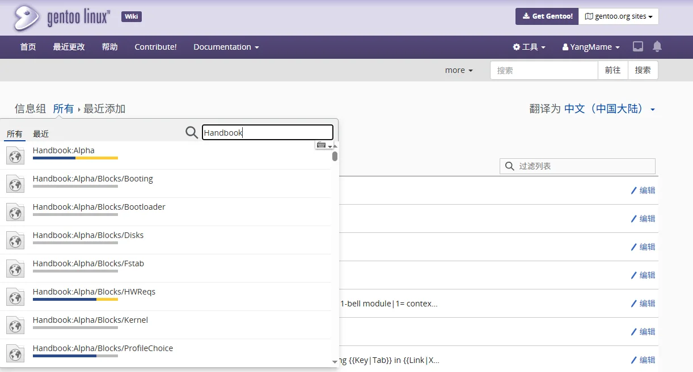
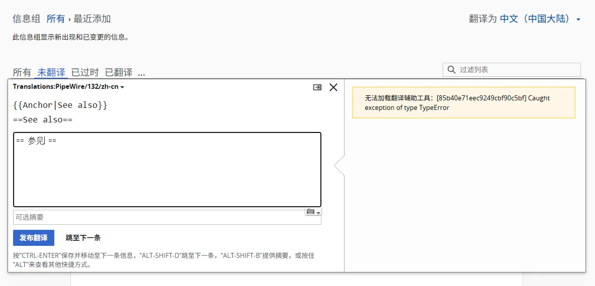
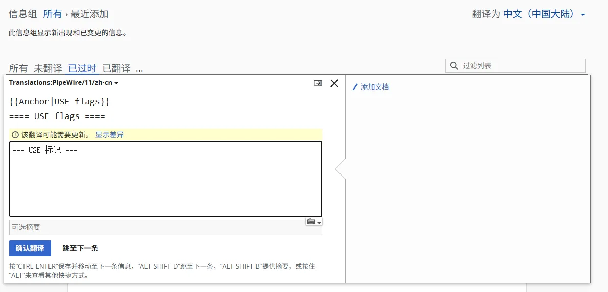
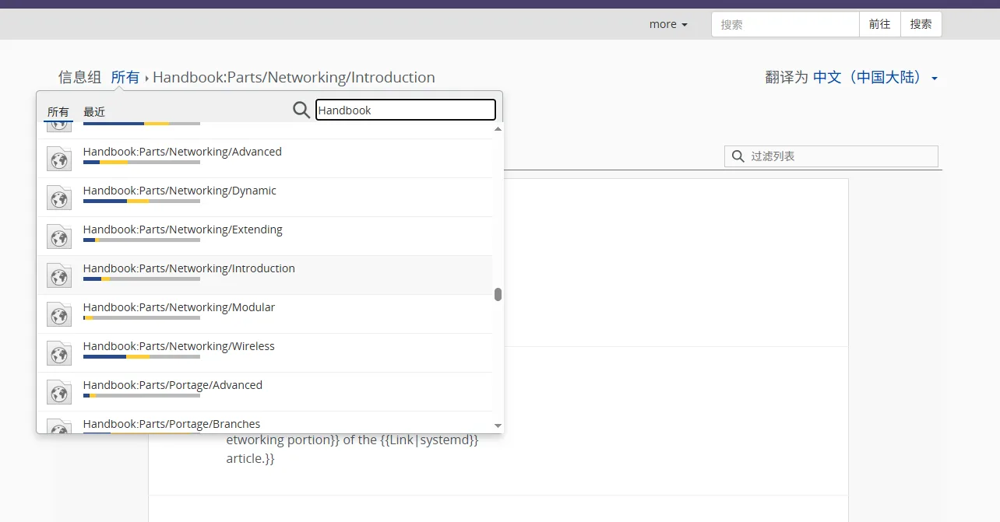
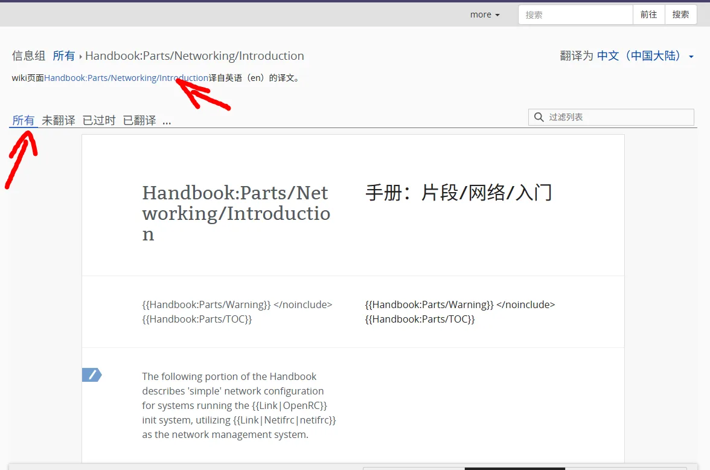

## Prerequisites

- Basic Linux knowledge
- Basic experience using Gentoo and Portage package management
- Good English skills and familiarity with most computing terminology

With enough patience, you can get started even if you do not meet every requirement.

## Preparation

Create a Gentoo Wiki account at [Special:CreateAccount](https://wiki.gentoo.org/index.php?title=Special:CreateAccount).

After registering, leave a message at [Gentoo Wiki:Translator account requests](https://wiki.gentoo.org/wiki/Gentoo_Wiki:Translator_account_requests) to request translation permissions for your account.

While waiting for approval, learn from 空空's [translation history](https://wiki.gentoo.org/index.php?title=Special:Contributions/%E7%A9%BA%E7%A9%BA&offset=&limit=500&target=%E7%A9%BA%E7%A9%BA).

## Getting Started

If you cannot find the translation interface, use [Special:Translate](https://wiki.gentoo.org/index.php?title=Special:Translate) to search for the page you want to translate:

You can also work directly on this page to add translations or check outdated translations.


Most text on this page appears without context. Translate each sentence carefully.


For example, add a translation:

Check an outdated translation:

When you are ready to translate a whole article, find an untranslated page you want to work on:

Switch to "All" to avoid missing context, or follow the link to the original article:

## Translation Guidelines

### Spelling

- Avoid unnecessary abbreviations where possible.
- Spell proper names as they appear on the project's official website.

### Wording

- Use formal, professional, precise language.
- Explain why as well as how. Explanations are more useful than instructions alone.
- Keep personal comments on talk pages, not in articles. Generally, avoid the first person.
- Give specific dates or times instead of writing "现在" ("now"), "当前" ("currently"), or similar terms.
- When editing, stay consistent with the rest of the page, including grammatical person.
- When presenting several options, describe the advantages and disadvantages of each objectively. Let readers choose rather than recommending one based on personal preference.
- When translating, avoid the second-person pronouns "你" and "您" where possible. If a second-person pronoun is necessary, follow the form already used in the existing translation. If both forms appear, consider using just one throughout. If neither appears, choose either form and use it consistently.

### Three Basic Principles

1. Always use edit summaries correctly.
2. Do not make large changes all at once.
3. Discuss changes before reorganizing a page.

These are established editing conventions for Chinese-language wikis, adapted from [Arch Linux Chinese Wiki: Three Basic Principles](https://wiki.archlinuxcn.org/wiki/Project:%E8%B4%A1%E7%8C%AE#%E4%B8%89%E4%B8%AA%E5%9F%BA%E6%9C%AC%E5%8E%9F%E5%88%99).

### Chinese Typography

- Do not add spaces between Chinese characters, even across formatting changes such as links.
- Avoid italicizing Chinese text where possible.

### Mixing Chinese and English

- Use half-width characters for English text and numbers.
- Do not add spaces between Chinese characters.
- Add spaces between Chinese text and English text, Arabic numerals, or symbols such as `@ # $ % ^ & * . ( )`.
- Do not add spaces between Chinese punctuation marks.
- Do not add spaces between Chinese punctuation and adjacent characters, whether full-width or half-width.
- When translating, replace common English punctuation in body text with Chinese punctuation.
- When the half-width slash `/` means "或者" ("or"), do not add spaces on either side.

These are established typography conventions for Chinese-language wikis, adapted from [Arch Linux Chinese Wiki: Style](https://wiki.archlinuxcn.org/wiki/Help:%E9%A3%8E%E6%A0%BC).

## About AI Translation

The Gentoo Council adopted its [AI policy](https://wiki.gentoo.org/wiki/Project:Council/AI_policy) in April 2024:

> It is expressly forbidden to contribute to Gentoo any content that has been created with the assistance of Natural Language Processing artificial intelligence tools. This motion can be revisited, should a case be made for such a tool that does not pose copyright, ethical and quality concerns.

Machine translation and large language models fall into this category. Do not have AI translate a page and submit the output directly; you must translate it yourself. This is a policy requirement and a matter of Wiki quality: AI translations often read fluently but use imprecise or ambiguous wording. The extensive human review they need increases the workload.

You may use dictionaries, terminology databases, and intelligent tools to help you understand the text, but choose the final wording and write it yourself.

## Further Reading

- [Gentoo Wiki translation help](https://wiki.gentoo.org/wiki/Help:Translating/zh-cn)
