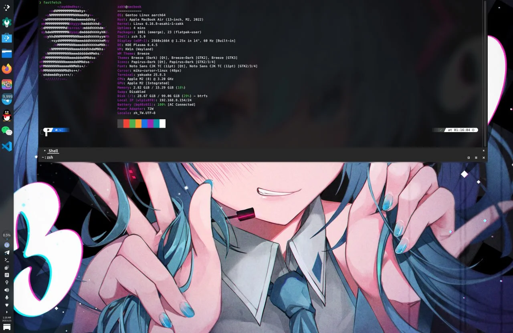
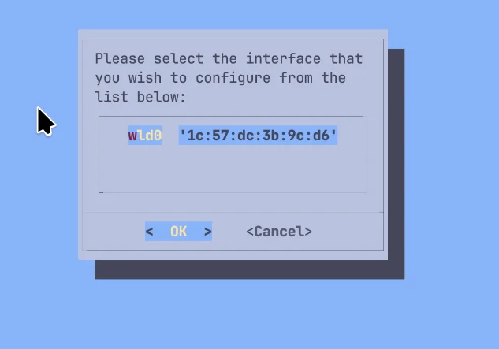
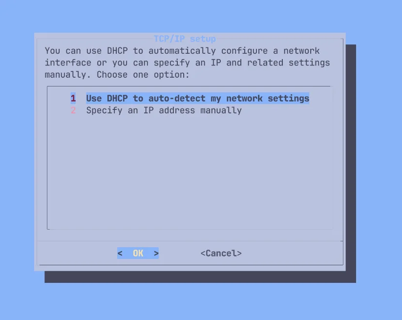

**2026-10-26 更新**：按 MacBook Air M2 实机安装重写，加入官方 binpkg，并实测 LUKS 加密。

在受支持的 M1/M2 Mac 上安装 ARM64 Gentoo，保留 macOS。Gentoo 使用 systemd；OpenRC 命令仅用于 Live USB。

安装指南：<https://wiki.gentoo.org/wiki/Project:Asahi/Guide>

分区前确认机型支持。M2 Mac Pro 安装支持仍为 WIP；本教程不涵盖后续世代。

M1 支持表：<https://asahilinux.org/docs/platform/feature-support/m1/>

M2 支持表：<https://asahilinux.org/docs/platform/feature-support/m2/>

各世代支持总表：<https://asahilinux.org/docs/platform/feature-support/overview/>

## 流程概览

1. 下载 Gentoo Asahi Live USB 镜像
2. 通过 Asahi 安装程序设置 U-Boot
3. 从 Live USB 启动
4. 分区并挂载文件系统
5. 解压 Stage3 并 chroot
6. 安装 Asahi 支持软件包
7. 重启完成安装

可选步骤：LUKS 加密、自定义内核、PipeWire 音频、桌面环境。

## 事前准备

### 硬件需求

- Asahi 安装程序支持的 M1/M2 Mac
- 至少 80 GB 可用磁盘空间，建议 120 GB 以上
- 稳定的 Wi-Fi 或以太网

### 已知工作情况

受支持的机型可使用 CPU、存储设备、Wi-Fi、笔记本键盘和触控板，以及 GPU 加速。显示和音频支持因机型而异。Thunderbolt 和 USB-C DisplayPort Alt Mode 标为 WIP，Touch ID 尚不支持。

macOS 虚拟化尚不支持。

## 1. 准备 Gentoo Asahi Live USB

### 1.1 下载镜像

下载 ISO 和同名的 `.sha256`，然后校验：

- <https://chadmed.au/pub/gentoo/install-arm64-asahi-20260827.iso>
- <https://chadmed.au/pub/gentoo/install-arm64-asahi-20260827.iso.sha256>

```bash
$ shasum -a 256 -c install-arm64-asahi-20260827.iso.sha256
```

显示 `OK` 再写入 USB。

20260827 版已在 MacBook Air M2 上验证可正常启动。20261006 版内置 GRUB 2.16，在 Asahi U-Boot 上启动时报错 `cannot allocate memory for memory map`，暂勿使用。

### 1.2 制作启动 USB

在下载目录用 `diskutil list` 找出 USB，替换 `/dev/disk4`。写入会清除 USB 数据：

```bash
$ diskutil list
$ diskutil unmountDisk /dev/disk4
$ sudo dd if=install-arm64-asahi-20260827.iso of=/dev/rdisk4 bs=4m
$ diskutil eject /dev/disk4
```

## 2. 设置 Asahi U-Boot 环境

### 2.1 运行 Asahi 安装程序

详情查看 <https://alx.sh> 。

在 macOS 中打开 Terminal，执行：

```bash
$ curl https://alx.sh | sh
```

加载后输入 sudo 密码，在 `Press enter to continue` 按 Enter。

以下为 MacBook Air（M2，2022）的输出。

```text
Collecting system information...
  Product name: MacBook Air (M2, 2022)
  SoC: Apple M2
  Device class: j413ap
  Product type: Mac14,2
  Board ID: 0x28
  Chip ID: 0x8112
  System firmware: mBoot-20457.1.29
  Boot UUID: 0396B26F-E9D1-47A3-AC3C-6D26CC3F2F64
  Boot VGID: 0396B26F-E9D1-47A3-AC3C-6D26CC3F2F64
  Default boot VGID: 0396B26F-E9D1-47A3-AC3C-6D26CC3F2F64
  Boot mode: macOS
  OS version: 27.0.1 (26A434)
  OS restore version: 26.1.434.0.0,0
  Main firmware version: 27.0.1 (26A434)
  No Fallback System Firmware / rOS
  SFR version: 26.1.434.0.0,0
  SystemRecovery version: 25.7.83.0.0,0 (26.6.2 25G83)
  Login user: zakk
```

### 2.2 跟随安装程序

1. 输入 `r` 缩小 macOS；已有足够未分配空间则选 `f`，跳到第 5 步。

   ```text
   Partitions in system disk (disk0):
     1: APFS [Macintosh HD] (494.38 GB, 6 volumes)
       OS: [B*] [Macintosh HD] macOS v27.0.1 [disk3s3s1, 0396B26F-E9D1-47A3-AC3C-6D26CC3F2F64]
     2: APFS (System Recovery) (5.37 GB, 2 volumes)
       OS: [  ] recoveryOS v27.0.1 [Primary recoveryOS]

     [B ] = Booted OS, [R ] = Booted recovery, [? ] = Unknown
     [ *] = Default boot volume

   Using OS 'Macintosh HD' (disk3s3s1) for machine authentication.

   Choose what to do:
     r: Resize an existing partition to make space for a new OS
     q: Quit without doing anything
   » Action (r): r
   ```

2. 输入缩小后 macOS 要保留的大小，剩下的空间留给 Gentoo。

   ```text
   We're going to resize this partition:
     APFS [Macintosh HD] (494.38 GB, 6 volumes)
     Total size: 494.38 GB
     Free space: 244.98 GB
     Available space: 206.98 GB
     Overhead: 0 B
     Minimum new size: 287.41 GB (58.13%)

   Enter the new size for your existing partition:
     You can enter a size such as '1GB', a fraction such as '50%',
     or the word 'min' for the smallest allowable size.

     Examples:
     30%  - 30% to macOS, 70% to the new OS
     80GB - 80GB to macOS, the rest to your new OS
     min  - Shrink macOS as much as (safely) possible

   » New size (min): 366GB
   ```

   `80GB` 为 macOS 保留 80 GB；`30%` 保留 30%、释放 70%；`min` 缩至安全下限。须为 Gentoo 留出至少 80 GB。下限取决于已用空间；输入被拒绝时，改填更大的值或 `min`。

   ```text
   Size is too small, please enter a value > 287.41 GB
   ```

3. 确认将释放的空间，在 `Continue?` 输入 `y`。

   ```text
   Resizing will free up 128.38 GB of space.

   Note: your system may appear to freeze during the resize.
   This is normal, just wait until the process completes.
   » Continue? (y/N): y
   ```

   出现 `Resize complete` 即完成，按 Enter 返回菜单。缩放失败时先处理错误，不要继续分区。

   ```text
   Finished APFS operation
   Resize complete. Press enter to continue.
   ```

4. 确认释放的空间：

   ```text
   Partitions in system disk (disk0):
     1: APFS [Macintosh HD] (366.00 GB, 6 volumes)
       OS: [B*] [Macintosh HD] macOS v27.0.1 [disk3s3s1, 0396B26F-E9D1-47A3-AC3C-6D26CC3F2F64]
     2: (free space: 128.38 GB)
     3: APFS (System Recovery) (5.37 GB, 2 volumes)
       OS: [  ] recoveryOS v27.0.1 [Primary recoveryOS]
   ```

   在操作菜单输入 `f`。

   ```text
   Choose what to do:
     f: Install an OS into free space
     r: Resize an existing partition to make space for a new OS
     q: Quit without doing anything
   » Action (f): f
   ```

5. 选择 `UEFI environment only (m1n1 + U-Boot + ESP)`，不要选 Fedora Asahi Remix。输入屏幕上的编号，不要固定填 `5`。

   ```text
   Choose an OS to install:
     1: Fedora Asahi Remix 44 with KDE Plasma
     2: Fedora Asahi Remix 44 with GNOME
     3: Fedora Asahi Remix 44 Server
     4: Fedora Asahi Remix 44 Minimal
     5: UEFI environment only (m1n1 + U-Boot + ESP)
   » OS: 5
   ```

   名称可自定义，开机时的卷列表会显示这个名称。本文填 `Gentoo Linux`。

   ```text
   Minimum required space for this OS: 3.00 GB

   Available free space: 128.38 GB

   Enter a name for your OS
   » OS name (UEFI boot): Gentoo Linux
   ```

6. 等待安装程序创建 stub macOS 和约 500 MB 的 EFI 分区。

   ```text
   Creating new stub macOS named Gentoo Linux
   ```

   再次输入 macOS 管理员密码，新系统会设为默认启动卷。

   ```text
   To continue the installation, you will need to enter your macOS
   admin credentials.
   Password for zakk:
   ```

7. 出现 `Installation successful!` 后，选 `y` 发送匿名报告、`n` 不发送，或 `d` 查看内容。

   ```text
   Installation successful!
   ```

   ```text
   Help us improve Asahi Linux!
   We'd love to know how many people are installing Asahi and on what
   kind of hardware. Would you mind sending a one-time installation
   report to us?

   This will only report what kind of machine you have, the OS you're
   installing, basic version info, and the rough install size.
   No personally identifiable information (such as serial numbers,
   specific partition sizes, etc.) is included. You can view the
   exact data that will be sent.

   Report your install?
     y: Yes
     n: No
     d: View the data that will be sent
   » Choice (y/n/d):
   ```

### 2.3 完成 Recovery 设置

按 Enter 查看最后的说明，再在关机提示处按 Enter：

```text
Press enter to shut down the system.
```

1. 等待 25 秒，让系统完全关机。
2. 按住电源键开机，只按一次，不要反复按。按住期间 Apple 标志下方的文字会变化：

   | 屏幕文字 | 操作 |
   | --- | --- |
   | `Continue holding for startup options...` | 继续按住 |
   | 正在载入启动选项...（`Loading startup options...`）| 松开电源键 |

3. 等待卷列表出现：`Macintosh HD`、`Gentoo Linux`（Asahi 图标）和“选项”。
4. 选择 `Gentoo Linux`，按“继续”。

   

5. `macOS Recovery` 会短暂出现。在 `Select a volume to recover` 选择平时的 macOS 卷、点击 `Next`，并按提示输入 macOS 账户凭据。
6. 出现 `Asahi Linux installer` 画面后，终端会自动执行第二步 `step2.sh`。这一步只改变 Gentoo 的安全级别，macOS 不受影响，过程中要输入两次 macOS 用户名和密码。

   按 Enter 继续：

   ```text
   -bash-3.2# /Volumes/Gentoo\ Linux/Finish\ Installation.app/Contents/Resources/step2.sh ; exit;

   Asahi Linux installer (second step)

   VGID: 053D3C79-831B-4D09-9D75-199B5AA0924B
   System volume: /Volumes/Gentoo Linux

   You will see some messages advising you that you are changing the
   security level of your system. These changes apply only to your
   Asahi Linux install, and are necessary to install a third-party OS.

   Apple Silicon platforms maintain a separate security level for each
   installed OS, and are designed to retain their security with mixed OSes.
   The security level of your macOS install will not be affected.

   You will be prompted for login credentials two times.
   Please enter your macOS credentials (for the macOS that you
   used to run the first step of the installation).

   Press enter to continue.
   ```

   输入 macOS 密码：

   ```text
   Operating on Volume Group UUID 053D3C79-831B-4D09-9D75-199B5AA0924B

   This utility is not meant for normal users or even sysadmins.
   It provides unabstracted access to capabilities which are normally handled for the user automatically when changing the security policy through GUIs such as the Startup Security Utility in macOS Recovery ("recoveryOS").
   It is possible to make your system security much weaker and therefore easier to compromise using this tool.
   This tool is not to be used in production environments.
   It is possible to render your system unbootable with this tool.
   It should only be used to understand how the security of Apple Silicon Macs works.
   Use at your own risk!

   Please enter password for user zakk:
   ```

   安装程序更新本机安全策略并显示结果。`Security Mode` 变为 `Permissive`，只应用于 Gentoo：

   ```text
   Local policy update is in progress, please wait...

   Resulting local policy:
   （芯片 ID 与哈希值，略）
   Security Mode:               Permissive (smb0 && smb1): 1
   3rd Party Kexts Status:      Disabled   (smb2): absent
   User-allowed MDM Control:    Disabled   (smb3): absent
   DEP-allowed MDM Control:     Disabled   (smb4): absent
   SIP Status:                  Enabled    (sip0): absent
   Signed System Volume Status: Enabled    (sip1): absent
   Kernel CTRR Status:          Disabled   (sip2): 1
   Boot Args Filtering Status:  Enabled    (sip3): absent
   ```

   输入 `y` 确认：

   ```text
   By setting a custom boot object, you will be putting your system into Permissive Security.

   Are you sure you want to do this? (enter y or n) y
   found raw boot object, deriving Mach-O boot properties...
   wrapping boot object payload...
   going to change bootpolicy to permissive...
   updating local machine policy...
   ```

   再输入一次 macOS 用户名和密码：

   ```text
   Username: zakk
   Password:
   installing boot object...
   done.

   Wrapping up...
   ```

   按 Enter 重启：

   ```text
   Installation complete! Press enter to reboot.
   ```

反复重启或要求重装 macOS，说明启动顺序有误。**先完全关机**：屏幕熄灭后等满 25 秒，再按住电源键一次。

仍然失败时，最后再进入 macOS，重新执行 `curl https://alx.sh | sh` 并选 `p`。

## 3. 从 Live USB 启动

插入 USB 开机，U-Boot 会自动启动 USB 的 GRUB。手动指定方式：

```
setenv boot_targets "usb"
setenv bootmeths "efi"
boot
```

### 3.1 连接 Wi-Fi

Live USB 没有 NetworkManager，用 `net-setup` 设置 Wi-Fi：

```bash
# net-setup
```

1. 选择无线网卡 `wld0`。

   

2. `Interface details` 确认网卡信息，选 `Yes`。
3. 选择网络类型：
   - `1`：有线网络
   - `2`：不用密码或 WEP 加密的 Wi-Fi
   - `3`：需要密码的 Wi-Fi（WPA/WPA2），一般家用网络选这个

   

4. 输入 Wi-Fi 名称（SSID）。

   

5. 输入 Wi-Fi 密码，长度 8 至 63 个字符。

   

6. `TCP/IP setup` 选 `1 Use DHCP to auto-detect my network settings`。

   

确认获得 IP，并检查 DNS：

```bash
# ip a show wld0
# ping -c 3 www.gentoo.org
```

内核已含 Apple Silicon Wi-Fi 驱动；连接不稳时改试 2.4 GHz。

### 3.2 开启 SSH

Live USB 只有 `root` 账户。设置 root 密码并启动 sshd：

```bash
# passwd
# rc-service sshd start
```

从另一台电脑连接，`192.168.8.155` 替换为 `ip a show wld0` 显示的地址：

```bash
$ ssh root@192.168.8.155
```

## 4. 分区与文件系统

只在 Asahi 安装程序留下的空间创建分区，不要删除、调整或格式化已有的 APFS、EFI 和 Recovery 分区。破坏引导分区可能需要另一台 Mac 执行 DFU 恢复，并清除内部 SSD。

查看分区：

```bash
# lsblk
```

```text
NAME        MAJ:MIN RM   SIZE RO TYPE MOUNTPOINTS
loop0         7:0    0 761.2M  1 loop /run/rootfsbase
sda           8:0    1 119.5G  0 disk /run/initramfs/live  ← Live USB
├─sda1        8:1    1   132K  0 part
├─sda2        8:2    1   2.8M  0 part
└─sda3        8:3    1 864.9M  0 part
nvme0n1     259:0    0 465.9G  0 disk
├─nvme0n1p1 259:1    0   500M  0 part             ← Apple 启动分区
├─nvme0n1p2 259:2    0 340.9G  0 part             ← macOS
├─nvme0n1p3 259:3    0   2.3G  0 part             ← Asahi 创建的 stub macOS
├─nvme0n1p4 259:4    0   477M  0 part             ← Asahi 的 EFI 分区，不能格式化
└─nvme0n1p5 259:5    0     5G  0 part             ← macOS Recovery
nvme0n2     259:6    0     3M  0 disk
nvme0n3     259:7    0   128M  0 disk
```

用标签找出 Asahi 的 EFI 分区，[4.2](#42-挂载-efi-分区) 会把它挂载到 `/boot`：

```bash
# blkid --label "EFI - GENTO"
```

```text
/dev/nvme0n1p4
```

名称不是 `Gentoo Linux` 时标签不同，用 `lsblk -o NAME,LABEL` 查看。

### 4.1 建立根分区

用 `cfdisk` 在空闲空间创建根分区：

```bash
# cfdisk /dev/nvme0n1
```

```text
                               Disk: /dev/nvme0n1
              Size: 465.92 GiB, 500277792768 bytes, 122138133 sectors
            Label: gpt, identifier: 6C5A96F2-EFC9-487C-8C3E-01FD5EA77896

    Device              Start         End    Sectors     Size Type
>>  /dev/nvme0n1p1          6      128005     128000     500M Apple Silicon boot
    /dev/nvme0n1p2     128006    89483525   89355520   340.9G Apple APFS
    /dev/nvme0n1p3   89483526    90093829     610304     2.3G Apple APFS
    /dev/nvme0n1p4   90093830    90215941     122112     477M EFI System
    Free space       90216192   120827418   30611227   116.8G
    /dev/nvme0n1p5  120827419   122138127    1310709       5G Apple Silicon recovery

 ┌────────────────────────────────────────────────────────────────────────────┐
 │ Partition name: iBootSystemContainer                                       │
 │ Partition UUID: CFF870A1-2D9E-4F35-AFC9-CA57BC99C880                       │
 │ Partition type: Apple Silicon boot (69646961-6700-11AA-AA11-00306543ECAC)  │
 │Filesystem UUID: 58427f17-22df-4ffc-af98-c3246489e9f7                       │
 │     Filesystem: apfs                                                       │
 └────────────────────────────────────────────────────────────────────────────┘
 [ Delete ]  [ Resize ]  [  Quit  ]  [  Type  ]  [  Help  ]  [  Write ]  [  Dump  ]
```

1. 用方向键选 `Free space`（本文为 116.8G）。
2. 选 `[ New ]`，大小直接按 Enter，使用全部空闲空间。
3. 确认 `Type` 为 `Linux filesystem`；不是的话选 `[ Type ]` 修改。
4. 选 `[ Write ]`，输入 `yes` 写入。
5. 选 `[ Quit ]` 退出。

新分区为 `/dev/nvme0n1p6`。

先创建挂载点：

```bash
# mkdir -p /mnt/gentoo
```

不加密：

```bash
# mkfs.btrfs /dev/nvme0n1p6     # 或 mkfs.ext4、mkfs.xfs
# mount /dev/nvme0n1p6 /mnt/gentoo
```

加密：

```bash
# cryptsetup luksFormat --type luks2 --pbkdf argon2id --hash sha512 --key-size 512 /dev/nvme0n1p6
```

确认时输入大写 `YES`，小写会显示 `Operation aborted.` 并中止。接着设置两次解锁密码：

```text
WARNING!
========
This will overwrite data on /dev/nvme0n1p6 irrevocably.

Are you sure? (Type 'yes' in capital letters): YES
Enter passphrase for /dev/nvme0n1p6:
Verify passphrase:
```

输入刚才设置的密码，解锁为 `/dev/mapper/gentoo-root`：

```bash
# cryptsetup luksOpen /dev/nvme0n1p6 gentoo-root
```

```text
Enter passphrase for /dev/nvme0n1p6:
```

在解锁后的设备上创建 Btrfs：

```bash
# mkfs.btrfs --label root /dev/mapper/gentoo-root
```

```text
btrfs-progs v7.0
See https://btrfs.readthedocs.io for more information.

NOTE: default settings have changed in version 6.19 (supported since linux 6.1):
      - enable block-group-tree (-O bgt)

Label:              root
UUID:               fdbfe710-3069-436f-8b2b-562317ea5774
Node size:          16384
Sector size:        4096        (CPU page size: 16384)
Filesystem size:    116.76GiB
Block group profiles:
  Data:             single            8.00MiB
  Metadata:         DUP               1.00GiB
  System:           DUP               8.00MiB
SSD detected:       yes
Zoned device:       no
Features:           extref, skinny-metadata, no-holes, free-space-tree, block-group-tree
Checksum:           crc32c
Number of devices:  1
Devices:
   ID        SIZE  PATH
    1   116.76GiB  /dev/mapper/gentoo-root
```

挂载根文件系统：

```bash
# mount /dev/mapper/gentoo-root /mnt/gentoo
```

### 4.2 挂载 EFI 分区

挂载 Asahi ESP，不要格式化；支持脚本需要其中的厂商固件。

```bash
# mkdir -p /mnt/gentoo/boot
# mount /dev/nvme0n1p4 /mnt/gentoo/boot
```

确认挂载的是 Asahi 的 EFI 分区，应看到 `m1n1` 和 `vendorfw`：

```bash
# ls /mnt/gentoo/boot
```

```text
asahi  m1n1  ubootefi.var  vendorfw
```

挂载完成后，`lsblk` 应如下：

```bash
# lsblk
```

```text
NAME            MAJ:MIN RM   SIZE RO TYPE  MOUNTPOINTS
loop0             7:0    0 761.2M  1 loop  /run/rootfsbase
sda               8:0    1 119.5G  0 disk  /run/initramfs/live
├─sda1            8:1    1   132K  0 part
├─sda2            8:2    1   2.8M  0 part
└─sda3            8:3    1 864.9M  0 part
nvme0n1         259:0    0 465.9G  0 disk
├─nvme0n1p1     259:8    0   500M  0 part
├─nvme0n1p2     259:9    0 340.9G  0 part
├─nvme0n1p3     259:10   0   2.3G  0 part
├─nvme0n1p4     259:11   0   477M  0 part  /mnt/gentoo/boot
├─nvme0n1p5     259:12   0     5G  0 part
└─nvme0n1p6     259:13   0 116.8G  0 part
  └─gentoo-root 252:0    0 116.8G  0 crypt /mnt/gentoo
nvme0n2         259:6    0     3M  0 disk
nvme0n3         259:7    0   128M  0 disk
```

## 5. Stage3 与 chroot

按 [Gentoo Handbook（ARM64）](https://wiki.gentoo.org/wiki/Handbook:ARM64) 安装，Stage3 使用 ARM64 版。时间不准时，先完成[第 5.3 节](#53-同步系统时间)再下载。

### 5.1 下载并解压 Stage3

本文使用 desktop systemd 版的 Stage3，最新版位于：

<https://distfiles.gentoo.org/releases/arm64/autobuilds/current-stage3-arm64-desktop-systemd/>

其他版本（例如 OpenRC）见 <https://www.gentoo.org/downloads/#arm64>，后文的 systemd 步骤需要自行替换。

下载 `.tar.xz` 和同名的 `.asc`，文件名换成目录中最新的日期：

```bash
# cd /mnt/gentoo
# wget https://distfiles.gentoo.org/releases/arm64/autobuilds/current-stage3-arm64-desktop-systemd/stage3-arm64-desktop-systemd-20261025T234555Z.tar.xz
# wget https://distfiles.gentoo.org/releases/arm64/autobuilds/current-stage3-arm64-desktop-systemd/stage3-arm64-desktop-systemd-20261025T234555Z.tar.xz.asc
```

先验证签名再解压，详情查看 <https://wiki.gentoo.org/wiki/Handbook:ARM64/Installation/Stage#Verifying_and_validating> 。

导入 Live USB 内置的 Gentoo 发布公钥：

```bash
# gpg --import /usr/share/openpgp-keys/gentoo-release.asc
```

验证签名：

```bash
# gpg --verify stage3-arm64-desktop-systemd-20261025T234555Z.tar.xz.asc
```

```text
gpg: assuming signed data in 'stage3-arm64-desktop-systemd-20261025T234555Z.tar.xz'
gpg: Signature made Mon Oct 26 04:01:10 2026 UTC
gpg:                using RSA key 534E4209AB49EEE1C19D96162C44695DB9F6043D
gpg: Good signature from "Gentoo Linux Release Engineering (Automated Weekly Release Key) <releng@gentoo.org>" [unknown]
gpg: WARNING: This key is not certified with a trusted signature!
gpg:          There is no indication that the signature belongs to the owner.
      13EBBDBEDE7A12775DFDB1BABB572E0E2D182910
      534E4209AB49EEE1C19D96162C44695DB9F6043D
```

看到 `Good signature` 即通过。`WARNING` 表示本机尚未信任这把公钥，属正常现象；指纹可与 <https://www.gentoo.org/downloads/signatures/> 比对。

解压：

```bash
# tar xpvf stage3-arm64-desktop-systemd-20261025T234555Z.tar.xz --xattrs-include='*.*' --numeric-owner
```

### 5.2 配置 Portage 仓库

```bash
# mkdir --parents /mnt/gentoo/etc/portage/repos.conf
# cp /mnt/gentoo/usr/share/portage/config/repos.conf /mnt/gentoo/etc/portage/repos.conf/gentoo.conf
```

### 5.3 同步系统时间

时间错误会导致 SSL 验证和 emerge 失败。用 chronyd 校时：

```bash
# chronyd -q
```

```text
2026-10-26T07:14:08Z chronyd version 4.8 starting (+CMDMON +REFCLOCK +RTC +PRIVDROP +SCFILTER -SIGND +NTS +SECHASH +IPV6 -DEBUG)
2026-10-26T07:14:08Z Wrong owner of /run/chrony (UID != 0)
2026-10-26T07:14:08Z Disabled command socket /run/chrony/chronyd.sock
2026-10-26T07:14:08Z Running with root privileges
2026-10-26T07:14:08Z Frequency 0.000 +/- 1000000.000 ppm read from /var/lib/chrony/drift
2026-10-26T07:14:12Z System clock wrong by 0.001650 seconds (step)
2026-10-26T07:14:12Z chronyd exiting
```

`System clock wrong by` 是校正的秒数。确认时间（UTC）：

```bash
# date
```

```text
Mon Oct 26 07:14:12 UTC 2026
```

### 5.4 挂载并进入 chroot

```bash
# cp --dereference /etc/resolv.conf /mnt/gentoo/etc/
# mount --types proc /proc /mnt/gentoo/proc
# mount --rbind /sys /mnt/gentoo/sys
# mount --make-rslave /mnt/gentoo/sys
# mount --rbind /dev /mnt/gentoo/dev
# mount --make-rslave /mnt/gentoo/dev
# mount --bind /run /mnt/gentoo/run
# mount --make-slave /mnt/gentoo/run

# chroot /mnt/gentoo /bin/bash
# source /etc/profile
# export PS1="(chroot) ${PS1}"
```

### 5.5 编辑 make.conf

编辑已有文件：

```conf
# /etc/portage/make.conf
CHOST="aarch64-unknown-linux-gnu"
COMMON_FLAGS="-march=native -O2 -pipe"
CFLAGS="${COMMON_FLAGS}"
CXXFLAGS="${COMMON_FLAGS}"
FCFLAGS="${COMMON_FLAGS}"
FFLAGS="${COMMON_FLAGS}"
RUSTFLAGS="-C target-cpu=native"
LC_MESSAGES=C
MAKEOPTS="-j4"
GENTOO_MIRRORS="https://tw.mirrors.cicku.me/gentoo/"
EMERGE_DEFAULT_OPTS="--jobs 3"
FEATURES="${FEATURES} getbinpkg"
VIDEO_CARDS="asahi"
GRUB_PLATFORMS="efi-64"
L10N="zh-CN zh-TW zh en"
```

`getbinpkg`：有官方编译好的包就直接下载，省去编译；想全部从源码编译就不要加这行。详情查看[官方二进制包配置](/gentoo-binpkg-setup/)。

默认使用官方列表中的 CICKU 台湾站；中国大陆可选 BFSU、USTC 或清华 TUNA。

官方镜像：<https://www.gentoo.org/downloads/mirrors/>

[Gentoo 镜像](/gentoo-mirrors/)

同步 Portage：

```bash
# emerge-webrsync
```

结尾如下，前面的 rsync 文件列表省略。新闻可稍后用 `eselect news read` 阅读：

```text
sent 126.58M bytes  received 2.67M bytes  13.61M bytes/sec
total size is 249.22M  speedup is 1.93

Performing Global Updates
(Could take a couple of minutes if you have a lot of binary packages.)

 * IMPORTANT: 17 news items need reading for repository 'gentoo'.
 * Use eselect news read to view new items.
```

设置时区。本文为 `Australia/Melbourne`，换成所在地时区，如 `Asia/Shanghai`、`Asia/Taipei`、`Asia/Hong_Kong`：

```bash
# ln -sf /usr/share/zoneinfo/Australia/Melbourne /etc/localtime
```

在已有文件中启用区域设置：

```conf
# /etc/locale.gen
en_US.UTF-8 UTF-8
zh_CN.UTF-8 UTF-8
zh_TW.UTF-8 UTF-8
```

生成并选择区域设置：

```bash
# locale-gen
```

```text
[1/4] Compiling locale: C.UTF-8
[2/4] Compiling locale: en_US.UTF-8
[3/4] Compiling locale: zh_CN.UTF-8
[4/4] Compiling locale: zh_TW.UTF-8
Waiting for active workers to finish their jobs ...
The location of the archive shall be '/usr/lib/locale/locale-archive'.
Adding 4 locales to the locale archive ...
Successfully installed an archive containing 4 locales, of 5.96 MiB in size.
```

```bash
# eselect locale set en_US.utf8
# env-update && source /etc/profile && export PS1="(chroot) ${PS1}"
```

## 6. 安装 Asahi 支持软件包 {#6-安装-asahi-支持套件}

两种方式都用 dracut 生成 initramfs，非加密系统也一样。先创建 USE 配置目录：

```bash
# mkdir -p /etc/portage/package.use
```

创建文件，已存在则追加设置：

```conf
# /etc/portage/package.use/installkernel
sys-kernel/installkernel dracut
```

安装 dracut 和内核安装集成软件包：

```bash
# emerge --ask sys-kernel/dracut sys-kernel/installkernel
```

确认 `installkernel` 带有 `dracut` USE 标志，按 Enter 安装：

```text
These are the packages that would be merged, in order:

Calculating dependencies ... done!
Dependency resolution took 0.28 s (backtrack: 0/20).

[ebuild  N     ] app-text/asciidoc-10.2.1::gentoo  USE="-test" PYTHON_SINGLE_TARGET="python3_14 -python3_12 -python3_13 (-python3_15)" 1,251 KiB
[ebuild  N     ] app-arch/cpio-2.15::gentoo  USE="nls" 1,613 KiB
[ebuild  N     ] app-alternatives/cpio-0::gentoo  USE="gnu -libarchive (-split-usr)" 0 KiB
[ebuild  N     ] sys-kernel/dracut-112::gentoo  USE="systemd -debug -dracut-cpio (-selinux) -test" 588 KiB
[ebuild  N     ] sys-kernel/installkernel-68-r1::gentoo  USE="dracut systemd -efistub -grub (-refind) -systemd-boot -ugrd -uki -ukify" 33 KiB

Total: 5 packages (5 new), Size of downloads: 3,484 KiB

Would you like to merge these packages? [Yes/No]
```

接下来的 Asahi 软件包、内核和 GRUB 有两种装法，任选其一，完成后都接 [6.3](#63-配置-fstab)：

| 方法 | 做法 | 适合 |
| --- | --- | --- |
| [A：脚本](#61-方法-a自动化脚本推荐) | 运行 `install.sh`，一次完成 | 想尽快装完 |
| [B：手动](#62-方法-b手动安装) | 逐条执行命令 | 想了解每一步做了什么，或脚本出错时 |

### 6.1 方法 A：自动化脚本 {#61-方法-a自动化脚本推荐}

以 root 在 chroot 内执行，Asahi ESP 挂载到 `/boot`，且须有 `/boot/vendorfw`。脚本会配置 Portage、启用 overlay，安装 Asahi 软件包、发行版内核和 GRUB，更新固件与 m1n1，但不更新 `@world`。

```bash
# emerge --sync
# emerge --ask dev-vcs/git

# cd /tmp
# git clone https://github.com/chadmed/asahi-gentoosupport
# cd asahi-gentoosupport
# ./install.sh
```

安装 Asahi 软件包时，脚本会因下面的错误停止（2026-10 实测）：

```text
 * Error: circular dependencies:

(sys-kernel/asahi-kernel-7.1.13_p3:asahi-7.1.13_p3/asahi-7.1.13_p3::asahi, ebuild scheduled for merge) depends on
 (sys-boot/m1n1-bin-1.6.1:0/0::asahi, ebuild scheduled for merge) (buildtime)
  (virtual/dist-kernel-7.1.13_p3:asahi/7.1.13_p3::asahi, ebuild scheduled for merge) (runtime)
   (sys-kernel/asahi-kernel-7.1.13_p3:asahi-7.1.13_p3/asahi-7.1.13_p3::asahi, ebuild scheduled for merge) (runtime_slot_op)

The following USE changes are necessary to proceed:
 (see "package.use" in the portage(5) man page for more details)
# required by media-libs/asahi-audio-4.1::asahi
# required by sys-apps/asahi-meta-3-r1::asahi[sound]
# required by sys-apps/asahi-meta (argument)
>=media-video/pipewire-1.6.9 extra lv2
```

有两个问题：

- `asahi-kernel`、`m1n1-bin` 和 `virtual/dist-kernel` 互相依赖，Portage 排不出顺序。
- `asahi-audio` 需要 pipewire 启用 `extra` 和 `lv2`。

创建 pipewire 的 USE 配置。不要写进 `package.use/asahi`，脚本每次执行都会覆盖它：

```conf
# /etc/portage/package.use/pipewire
>=media-video/pipewire-1.6.9 extra lv2
```

先单独安装 `u-boot` 和 `m1n1-bin` 解开循环，再重新执行脚本：

```bash
# emerge --oneshot sys-boot/u-boot
# emerge --oneshot --nodeps sys-boot/m1n1-bin
# ./install.sh
```

完成后跳到[第 6.3 节](#63-配置-fstab)。

### 6.2 方法 B：手动安装

保留[第 5.2 节](#52-配置-portage-仓库)的 Gentoo 仓库，另外加入 Asahi。

Overlay：<https://github.com/chadmed/asahi-overlay>

```bash
# emerge --ask dev-vcs/git
# mkdir -p /etc/portage/repos.conf /etc/portage/package.mask /etc/portage/package.use /etc/portage/package.license
```

创建仓库配置文件：

```conf
# /etc/portage/repos.conf/asahi.conf
[asahi]
location = /var/db/repos/asahi
sync-type = git
sync-uri = https://github.com/chadmed/asahi-overlay.git
auto-sync = yes
```

同步两个仓库：

```bash
# emerge --sync
```

创建屏蔽文件，禁用 Gentoo 的 dist-kernel 虚拟包：

```conf
# /etc/portage/package.mask/asahi
virtual/dist-kernel::gentoo
```

创建 Rust 的 USE 配置文件：

```conf
# /etc/portage/package.use/asahi
dev-lang/rust-bin rustfmt rust-src
dev-lang/rust rustfmt rust-src
```

如果接受这些固件许可证，创建许可证配置文件：

```conf
# /etc/portage/package.license/firmware
sys-kernel/linux-firmware linux-fw-redistributable no-source-code
```

先处理[第 6.1 节](#61-方法-a自动化脚本推荐)提到的循环依赖和 pipewire USE：

```conf
# /etc/portage/package.use/pipewire
>=media-video/pipewire-1.6.9 extra lv2
```

```bash
# emerge --oneshot sys-boot/u-boot
# emerge --oneshot --nodeps sys-boot/m1n1-bin
```

再安装 Asahi 软件包和内核。`asahi-meta` 包含 m1n1、U-Boot、固件工具和 Mesa；`virtual/dist-kernel:asahi` 会选用 `sys-kernel/asahi-kernel`：

```bash
# emerge -q1 dev-lang/rust-bin
# emerge -q sys-apps/asahi-meta virtual/dist-kernel:asahi sys-kernel/linux-firmware
```

更新固件与引导程序：

```bash
# asahi-fwupdate
```

```text
Mounted System ESP /dev/nvme0n1p4 at /run/.system-efi
Upgrading vendor firmware package
Firmware upgraded
```

```bash
# update-m1n1
```

```text
Mounted System ESP /dev/nvme0n1p4 at /run/.system-efi
m1n1 updated at /run/.system-efi/m1n1/boot.bin
```

看到 `Firmware upgraded` 和 `m1n1 updated` 即完成。

安装 GRUB：

```bash
# emerge -q grub:2
```

```bash
# grub-install --boot-directory=/boot/ --efi-directory=/boot/ --removable
```

```text
Installing for arm64-efi platform.
Installation finished. No error reported.
```

```bash
# grub-mkconfig -o /boot/grub/grub.cfg
```

```text
Generating grub configuration file ...
Found theme: /boot/grub/themes/gentoo_glass/theme.txt
Found linux image: /boot/kernel-7.1.13-p3-asahi-dist
Found initrd image: /boot/initramfs-7.1.13-p3-asahi-dist.img
Warning: os-prober will not be executed to detect other bootable partitions.
Systems on them will not be added to the GRUB boot configuration.
Check GRUB_DISABLE_OS_PROBER documentation entry.
Adding boot menu entry for UEFI Firmware Settings ...
done
```

输出要列出 `kernel-…-asahi-dist` 和对应的 `initramfs`。os-prober 的警告可以忽略：macOS 在 Apple 启动选项中选择，不经过 GRUB。

### 6.3 配置 fstab

两种方式完成后都要检查更新：

```bash
# emerge --ask --update --deep --changed-use @world
```

查询 ESP 和根文件系统的 UUID。加密时查询 `/dev/mapper/gentoo-root`，不是 LUKS 容器；未加密改为查询 `/dev/nvme0n1p6`：

```bash
# blkid /dev/nvme0n1p4 /dev/mapper/gentoo-root
```

```text
/dev/nvme0n1p4: LABEL_FATBOOT="EFI - GENTO" LABEL="EFI - GENTO" UUID="A894-131F" BLOCK_SIZE="4096" TYPE="vfat" PARTUUID="0fedd0ab-a4bf-4db8-8ce4-35bacfe76eee"
/dev/mapper/gentoo-root: LABEL="root" UUID="fdbfe710-3069-436f-8b2b-562317ea5774" UUID_SUB="8328eeba-be3f-4898-b6ad-10ebbc4a52d6" BLOCK_SIZE="4096" TYPE="btrfs"
```

Stage3 的 `/etc/fstab` 只有注释示例。把下面两行追加到文件末尾，`UUID=` 换成上面输出的值；ext4、xfs 系统将 `btrfs` 改为 `ext4` 或 `xfs`：

```fstab
# /etc/fstab
UUID=fdbfe710-3069-436f-8b2b-562317ea5774  /      btrfs  defaults  0 1
UUID=A894-131F                             /boot  vfat   defaults  0 2
```

检查语法：

```bash
# findmnt --verify
```

```text
Success, no errors or warnings detected
```

根目录是 btrfs 时安装 `btrfs-progs`，stage3 没有内置；[6.4](#64-配置-luks仅加密用户) 的 dracut 配置要用到它。xfs 安装 `sys-fs/xfsprogs`；ext4 的 `e2fsprogs` 已内置：

```bash
# emerge --ask sys-fs/btrfs-progs
```

### 6.4 配置 LUKS（仅加密用户）

创建 USE 文件，已存在则追加设置：

```conf
# /etc/portage/package.use/fde
sys-apps/systemd cryptsetup
```

重新构建 systemd，启用 cryptsetup 支持：

```bash
# emerge --ask --oneshot sys-apps/systemd
```

查询 LUKS 容器的 UUID：

```bash
# blkid /dev/nvme0n1p6
```

```text
/dev/nvme0n1p6: UUID="972bc0a0-5a14-4c98-88bb-b2455cebbbbf" TYPE="crypto_LUKS" PARTUUID="090a74b8-8f56-4b5f-aaab-41c9cbf85ebb"
```

编辑 `GRUB_CMDLINE_LINUX`，保留其他必要参数。ext4、xfs 系统改用 `rootfstype=ext4` 或 `rootfstype=xfs`：

```conf
# /etc/default/grub
GRUB_CMDLINE_LINUX="rd.luks.name=972bc0a0-5a14-4c98-88bb-b2455cebbbbf=gentoo-root rootfstype=btrfs rd.luks.options=discard"
```

- `rd.luks.name=<LUKS-UUID>=gentoo-root`：解锁容器，将设备命名为 `gentoo-root`
- 不用写 `root=`：`grub-mkconfig` 会检测当前的根目录，自动加上 `root=UUID=…`，解锁后即可找到
- `rd.luks.options=discard`：允许 SSD TRIM 穿透加密层（要权衡安全性）

创建 dracut 配置目录：

```bash
# mkdir -p /etc/dracut.conf.d
```

创建加密根目录配置文件。ext4 系统从 `add_dracutmodules` 中删除 `btrfs`，将 `filesystems` 改为 `ext4`：

```conf
# /etc/dracut.conf.d/luks.conf
kernel_cmdline=""
add_dracutmodules+=" btrfs systemd crypt dm "
filesystems+=" btrfs "
```

可选：在 crypttab 中追加根设备映射，使用相同的 LUKS UUID。

```conf
# /etc/crypttab
gentoo-root UUID=972bc0a0-5a14-4c98-88bb-b2455cebbbbf none luks,discard
```

生成 initramfs：

```bash
# dracut --force --regenerate-all
```

确认 initramfs 包含 `systemd-cryptsetup` 和 `dm-crypt`，缺少一项启动时就无法解锁；创建了 crypttab 的话也会列出：

```bash
# lsinitrd /boot/initramfs-7.1.13-p3-asahi-dist.img | grep -E 'bin/systemd-cryptsetup|dm-crypt.ko|etc/crypttab'
```

```text
-rw-r--r--   1 root     root           85 Oct 26 09:06 etc/crypttab
-rwxr-xr-x   1 root     root       134576 Oct 26 09:00 usr/bin/systemd-cryptsetup
-rw-r--r--   1 root     root        88160 Oct 26 08:39 usr/lib/modules/7.1.13-p3-asahi-dist/kernel/drivers/md/dm-crypt.ko
lrwxrwxrwx   1 root     root           28 Oct 26 09:06 usr/lib/systemd/systemd-cryptsetup -> ../../bin/systemd-cryptsetup
```

重新生成 GRUB 配置，输出与 [6.2](#62-方法-b手动安装) 相同。再确认内核参数同时包含 `root=UUID=…` 和 `rd.luks.name=…`：

```bash
# grub-mkconfig -o /boot/grub/grub.cfg
# grep -m1 'linux.*/kernel' /boot/grub/grub.cfg
```

```text
linux	/kernel-7.1.13-p3-asahi-dist root=UUID=fdbfe710-3069-436f-8b2b-562317ea5774 ro rd.luks.name=972bc0a0-5a14-4c98-88bb-b2455cebbbbf=gentoo-root rootfstype=btrfs rd.luks.options=discard
```

`installkernel[dracut]` 会在安装内核时生成 initramfs；Asahi scripts 的安装钩子则执行 `update-m1n1`。

## 7. 完成与重启

### 7.1 主机名

创建或替换主机名文件：

```conf
# /etc/hostname
macbook
```

### 7.2 网络

安装 NetworkManager，开机时自动启动：

```bash
# emerge --ask net-misc/networkmanager
# systemctl enable NetworkManager
```

### 7.3 账户与 sudo

设置 root 密码：

```bash
# passwd root
```

创建日常使用的账户，加入 `wheel` 组并设置密码：

```bash
# useradd -m -G wheel,audio,video,usb,input <用户名>
# passwd <用户名>
```

stage3 不含 sudo。安装后让 `wheel` 组的用户通过 sudo 执行管理命令，`visudo -c` 检查语法：

```bash
# emerge --ask app-admin/sudo
# mkdir -p /etc/sudoers.d
# echo '%wheel ALL=(ALL:ALL) ALL' > /etc/sudoers.d/wheel
# chmod 440 /etc/sudoers.d/wheel
# visudo -c
```

### 7.4 SSH（可选）

重启后要从其他电脑通过 SSH 登录，先放入公钥并启用 sshd。Gentoo 的 sshd 默认不接受密码登录，所以只能用密钥；主机密钥会在 sshd 第一次启动时生成：

```bash
# mkdir -p -m 700 /root/.ssh
# echo "ssh-ed25519 AAAA… you@laptop" >> /root/.ssh/authorized_keys
# chmod 600 /root/.ssh/authorized_keys
# systemctl enable sshd
```

### 7.5 退出并重启

退出 chroot 并重启：

```bash
# exit
# cd /
# umount -R /mnt/gentoo
# cryptsetup luksClose gentoo-root   # 若使用加密
# reboot
```

首次启动顺序：U-Boot → GRUB（选 Gentoo）→（若加密）输入 LUKS 密码 → 登录提示。

## 8. 安装后配置

### 8.1 网络

```bash
$ sudo nmtui
```

### 8.2 桌面环境

以 KDE Plasma 为例。切换到 Plasma 的 systemd profile，再更新系统：

```bash
# eselect profile list
# eselect profile set default/linux/arm64/23.0/desktop/plasma/systemd
# emerge -avuDN @world
```

安装 Plasma，启用并立即启动登录界面 SDDM：

```bash
# emerge --ask kde-plasma/plasma-meta kde-apps/kate kde-apps/dolphin
# systemctl enable --now sddm
```

### 8.3 字体与中文输入

桌面环境已经带入英文字体：fontconfig 依赖的 `virtual/ttf-fonts` 会安装 `liberation-fonts`，KDE 另外安装 `noto`。中文需要另外安装 `noto-cjk`：

```bash
# emerge --ask media-fonts/noto-cjk
```

以 Rime 为例。`fcitx-rime`、`fcitx-qt` 和 `fcitx-configtool` 在 arm64 上仍是测试版，要先接受测试关键字：

```bash
# mkdir -p /etc/portage/package.accept_keywords
```

```conf
# /etc/portage/package.accept_keywords/fcitx
app-i18n/fcitx-rime ~arm64
app-i18n/fcitx-qt ~arm64
app-i18n/fcitx-configtool ~arm64
```

`fcitx-configtool` 要启用 `kcm`，「系统设置」才会有输入法页面：

```conf
# /etc/portage/package.use/fcitx
app-i18n/fcitx-configtool kcm
```

安装输入法和配置工具：

```bash
# emerge --ask app-i18n/fcitx-rime app-i18n/fcitx-configtool
```

登录 Plasma 后：

1. 「系统设置 → 键盘 → 虚拟键盘」选择 Fcitx 5。
2. 「系统设置 → 输入法」点击「添加输入法」，加入 Rime。


Plasma 6.8 起不再支持 X11。


让 XWayland 程序也能使用输入法，重新登录后生效：

```bash
$ mkdir -p ~/.config/environment.d
$ echo 'XMODIFIERS=@im=fcitx' > ~/.config/environment.d/fcitx.conf
```

按 Ctrl+Space 切换到 Rime，第一次切换会先部署词库。F4 切换方案（朙月拼音、注音、仓颉等），Shift 切换中英文。

### 8.4 音频

`asahi-audio` 已在第 6 节随 `asahi-meta` 安装。

以 root 为所有用户启用 PipeWire 和 WirePlumber。`--global` 不需要用户登录；用 `su` 切换的身份没有用户级 systemd，`systemctl --user` 会失败：

```bash
# systemctl --global enable pipewire-pulse.socket wireplumber.service
```

登录桌面后确认音频设备：

```bash
$ wpctl status
```

输出的 Audio 部分（节选）。`asahi-audio` 的扬声器滤波器 `audio_effect.j413-convolver` 标有 `*`，表示它是默认输出；`j413` 是 MacBook Air M2 的型号代号，其他机型名称不同：

```text
Audio
 ├─ Devices:
 │      55. Built-in Audio                      [alsa]
 │      56. Built-in Audio                      [alsa]
 │
 ├─ Sinks:
 │      62. Built-in Audio Headphones           [vol: 1.00]
 │
 ├─ Sources:
 │      63. Built-in Audio Headset Microphone   [vol: 1.00]
 │
 ├─ Filters:
 │    - filter-chain-1639-18
 │      64. audio_effect.j413-mic                                        [Stream/Input/Audio]
 │  *   65. effect_output.j413-mic                                       [Audio/Source]
 │    - filter-chain-1639-19
 │  *   75. audio_effect.j413-convolver                                  [Audio/Sink]
 │      76. effect_output.j413-convolver                                 [Stream/Output/Audio]
```

### 8.5 睡眠

Apple Silicon 在 Linux 下只支持 s2idle 睡眠，不支持休眠：

```bash
$ cat /sys/power/mem_sleep
```

```text
[s2idle]
```

关闭休眠相关选项，KDE 就不会显示用不了的「休眠」：

```bash
# mkdir -p /etc/systemd/sleep.conf.d
```

```ini
# /etc/systemd/sleep.conf.d/asahi.conf
[Sleep]
AllowHibernation=no
AllowHybridSleep=no
AllowSuspendThenHibernate=no
```

合上屏幕即进入睡眠，打开屏幕或按任意键唤醒。

## 9. 系统维护

定期更新：

```bash
# emerge --sync
# emerge --ask --update --deep --newuse @world
# emerge --ask --depclean
# dispatch-conf
```

`emerge --sync` 会同步 Asahi overlay，`emerge-webrsync` 不会。只同步 Asahi 时可用 `emaint sync -r asahi`。

更新内核、U-Boot 或 m1n1 后，更新引导文件：

```bash
# update-m1n1
# grub-mkconfig -o /boot/grub/grub.cfg
```

m1n1 Stage 2 提供内核识别硬件所需的设备树；`sys-apps/asahi-scripts` 的 installkernel hook 可自动更新。

保留 macOS 以获取固件更新。

## 10. 常见问题

**无法从 USB 启动**：U-Boot 的 USB 驱动较挑剔，尝试不同 USB、使用 USB 2.0 设备、或经过 USB Hub。

**启动停滞或黑屏**：确认内核与 m1n1 设备树匹配，且 `update-m1n1` 已在挂载 ESP 后执行成功。Recovery 设置失败则回 macOS 选 `p` 重试（[第 2.3 节](#23-完成-recovery-设置)）。

**加密分区无法解锁**：从 Live USB 启动，解锁并挂载系统，再按 [5.4](#54-挂载并进入-chroot) 进入 chroot：

```bash
# cryptsetup luksOpen /dev/nvme0n1p6 gentoo-root
# mount /dev/mapper/gentoo-root /mnt/gentoo
# mount /dev/nvme0n1p4 /mnt/gentoo/boot
```

在 chroot 内确认 `GRUB_CMDLINE_LINUX` 的 UUID 与 `blkid /dev/nvme0n1p6` 相同，修正后执行 `grub-mkconfig -o /boot/grub/grub.cfg`。

**Wi-Fi 不稳定**：如果使用 WPA3 或 6 GHz，可改试 WPA2、2.4 GHz 或 5 GHz，确认是否与加密模式或频段有关。

**触控板失灵**：

```bash
# dmesg | grep -i firmware
# emerge --ask sys-apps/asahi-meta
```

## 11. 进阶选项

### 11.1 显示刘海两侧

默认画面避开刘海，顶部少一条显示区域。在 `GRUB_CMDLINE_LINUX` 末尾加入 `appledrm.show_notch=1`，让画面延伸到刘海两侧：

```conf
# /etc/default/grub
GRUB_CMDLINE_LINUX="rd.luks.name=972bc0a0-5a14-4c98-88bb-b2455cebbbbf=gentoo-root rootfstype=btrfs rd.luks.options=discard appledrm.show_notch=1"
```

重新生成 GRUB 配置并重启：

```bash
# grub-mkconfig -o /boot/grub/grub.cfg
# reboot
```

重启后确认，输出 `Y` 表示已生效：

```bash
$ cat /sys/module/appledrm/parameters/show_notch
```

```text
Y
```

刘海会挡住顶端中间。KDE Plasma 可以把面板放在顶部，高度对齐刘海底部，让刘海落在面板里。

### 11.2 自定义内核

用 `eselect kernel set` 选中刚安装的 `asahi-sources`，以当前运行内核的配置为基础再调整：

```bash
# emerge --ask sys-kernel/asahi-sources
# eselect kernel list
# eselect kernel set <number>
# cd /usr/src/linux
# zcat /proc/config.gz > .config
# make olddefconfig
# make menuconfig
# make -j$(nproc)
# make modules_install
# make install
# update-m1n1
# grub-mkconfig -o /boot/grub/grub.cfg
```

保留当前可启动的内核，新内核无法启动时可在 GRUB 选回旧版本。

### 11.3 切换内核

`update-m1n1` 从 `/usr/src/linux` 获取设备树（见 `/etc/default/update-m1n1`），所以要切换启动的内核，先把 `/usr/src/linux` 指向该版本：

```bash
# eselect kernel list
# eselect kernel set <number>
# update-m1n1
# grub-mkconfig -o /boot/grub/grub.cfg
```

重启后在 GRUB 选择同一版本，登录后用 `uname -r` 确认。设备树与内核版本不一致时可能无法启动。

## 参考

- [Gentoo Wiki: Project:Asahi/Guide](https://wiki.gentoo.org/wiki/Project:Asahi/Guide)
- [Asahi Linux 官方站](https://asahilinux.org/)
- [Asahi Linux Feature Support](https://asahilinux.org/docs/platform/feature-support/overview/)
- [Gentoo Handbook：Stage3 验证](https://wiki.gentoo.org/wiki/Handbook:ARM64/Installation/Stage)
- [asahi-gentoosupport](https://github.com/chadmed/asahi-gentoosupport)
- [Gentoo Asahi Releng](https://github.com/chadmed/gentoo-asahi-releng)
- [User:Jared/Gentoo On An M1 Mac](https://wiki.gentoo.org/wiki/User:Jared/Gentoo_On_An_M1_Mac)
- [Gentoo 发布签名](https://www.gentoo.org/downloads/signatures/)
- [Gentoo 源码镜像](https://www.gentoo.org/downloads/mirrors/)
- [GCC Apple CPU 定义](https://github.com/gcc-mirror/gcc/blob/master/gcc/config/aarch64/aarch64-cores.def)

社区支持：

- Telegram 群：[@gentoo_zh](https://t.me/gentoo_zh)
- Telegram 频道：[@gentoocn](https://t.me/gentoocn)
- [GitHub](https://github.com/gentoo-zh)
- [Gentoo Forums](https://forums.gentoo.org/)
- IRC `#gentoo` / `#asahi` @ [Libera.Chat](https://libera.chat/)
- [Asahi Linux Discord](https://discord.gg/asahi-linux)
