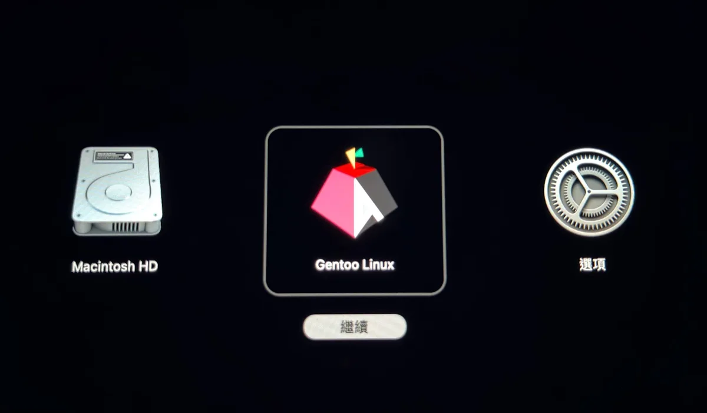
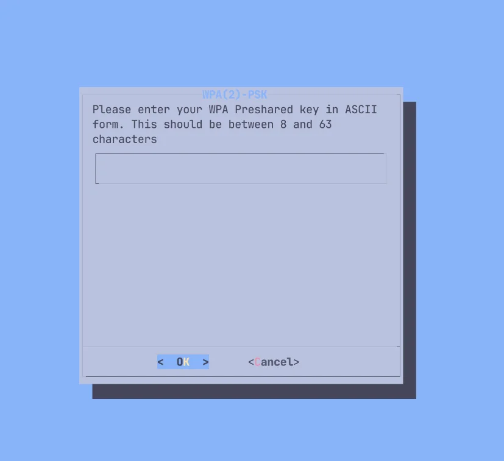

**2026-10-26 更新**：依 MacBook Air M2 實機安裝重寫，加入官方 binpkg，並實測 LUKS 加密。

在支援的 M1/M2 Mac 上安裝 ARM64 Gentoo，保留 macOS。Gentoo 使用 systemd；OpenRC 指令只用於 Live USB。

安裝指南：<https://wiki.gentoo.org/wiki/Project:Asahi/Guide>

分割磁碟前確認機型支援。M2 Mac Pro 安裝支援仍為 WIP；本教學不涵蓋後續世代。

M1 支援表：<https://asahilinux.org/docs/platform/feature-support/m1/>

M2 支援表：<https://asahilinux.org/docs/platform/feature-support/m2/>

各世代支援總表：<https://asahilinux.org/docs/platform/feature-support/overview/>

## 流程概覽

1. 下載 Gentoo Asahi Live USB 映像檔
2. 透過 Asahi 安裝程式設定 U-Boot
3. 從 Live USB 啟動
4. 分割區並掛載檔案系統
5. 解壓 Stage3 並 chroot
6. 安裝 Asahi 支援套件
7. 重啟完成安裝

選用項目：LUKS 加密、自訂核心、PipeWire 音訊、桌面環境。

## 事前準備

### 硬體需求

- Asahi 安裝程式支援的 M1/M2 Mac
- 至少 80 GB 可用磁碟空間，建議 120 GB 以上
- 穩定的 Wi-Fi 或乙太網

### 已知工作情況

支援機型可使用 CPU、儲存裝置、Wi-Fi、筆電鍵盤與觸控板，以及 GPU 加速。顯示與音訊支援依機型而異。Thunderbolt 與 USB-C DisplayPort Alt Mode 標為 WIP，Touch ID 尚不支援。

macOS 虛擬化尚不支援。

## 1. 準備 Gentoo Asahi Live USB

### 1.1 下載鏡像

下載 ISO 和同名的 `.sha256`，然後校驗：

- <https://chadmed.au/pub/gentoo/install-arm64-asahi-20260827.iso>
- <https://chadmed.au/pub/gentoo/install-arm64-asahi-20260827.iso.sha256>

```bash
$ shasum -a 256 -c install-arm64-asahi-20260827.iso.sha256
```

顯示 `OK` 再寫入 USB。

20260827 版已在 MacBook Air M2 上驗證可正常啟動。20261006 版內建 GRUB 2.16，在 Asahi U-Boot 上啟動時報錯 `cannot allocate memory for memory map`，暫勿使用。

### 1.2 製作啟動 USB

在下載目錄用 `diskutil list` 找出 USB，替換 `/dev/disk4`。寫入會清除 USB 資料：

```bash
$ diskutil list
$ diskutil unmountDisk /dev/disk4
$ sudo dd if=install-arm64-asahi-20260827.iso of=/dev/rdisk4 bs=4m
$ diskutil eject /dev/disk4
```

## 2. 設定 Asahi U-Boot 環境

### 2.1 執行 Asahi 安裝程式

詳情查看 <https://alx.sh> 。

在 macOS 開啟 Terminal，執行：

```bash
$ curl https://alx.sh | sh
```

載入後輸入 sudo 密碼，在 `Press enter to continue` 按 Enter。

以下為 MacBook Air（M2，2022）的輸出。

```text
Collecting system information...
  Product name: MacBook Air (M2, 2022)
  SoC: Apple M2
  Device class: j413ap
  Product type: Mac14,2
  Board ID: 0x28
  Chip ID: 0x8112
  System firmware: mBoot-20457.1.29
  Boot UUID: 0396B26F-E9D1-47A3-AC3C-6D26CC3F2F64
  Boot VGID: 0396B26F-E9D1-47A3-AC3C-6D26CC3F2F64
  Default boot VGID: 0396B26F-E9D1-47A3-AC3C-6D26CC3F2F64
  Boot mode: macOS
  OS version: 27.0.1 (26A434)
  OS restore version: 26.1.434.0.0,0
  Main firmware version: 27.0.1 (26A434)
  No Fallback System Firmware / rOS
  SFR version: 26.1.434.0.0,0
  SystemRecovery version: 25.7.83.0.0,0 (26.6.2 25G83)
  Login user: zakk
```

### 2.2 跟隨安裝程式

1. 輸入 `r` 縮小 macOS；已有足夠未配置空間則選 `f`，跳到第 5 步。

   ```text
   Partitions in system disk (disk0):
     1: APFS [Macintosh HD] (494.38 GB, 6 volumes)
       OS: [B*] [Macintosh HD] macOS v27.0.1 [disk3s3s1, 0396B26F-E9D1-47A3-AC3C-6D26CC3F2F64]
     2: APFS (System Recovery) (5.37 GB, 2 volumes)
       OS: [  ] recoveryOS v27.0.1 [Primary recoveryOS]

     [B ] = Booted OS, [R ] = Booted recovery, [? ] = Unknown
     [ *] = Default boot volume

   Using OS 'Macintosh HD' (disk3s3s1) for machine authentication.

   Choose what to do:
     r: Resize an existing partition to make space for a new OS
     q: Quit without doing anything
   » Action (r): r
   ```

2. 輸入縮小後 macOS 要保留的大小，剩下的空間留給 Gentoo。

   ```text
   We're going to resize this partition:
     APFS [Macintosh HD] (494.38 GB, 6 volumes)
     Total size: 494.38 GB
     Free space: 244.98 GB
     Available space: 206.98 GB
     Overhead: 0 B
     Minimum new size: 287.41 GB (58.13%)

   Enter the new size for your existing partition:
     You can enter a size such as '1GB', a fraction such as '50%',
     or the word 'min' for the smallest allowable size.

     Examples:
     30%  - 30% to macOS, 70% to the new OS
     80GB - 80GB to macOS, the rest to your new OS
     min  - Shrink macOS as much as (safely) possible

   » New size (min): 366GB
   ```

   `80GB` 為 macOS 保留 80 GB；`30%` 保留 30%、釋出 70%；`min` 縮至安全下限。須為 Gentoo 留出至少 80 GB。下限取決於已用空間；數值被拒絕時，改填較大的值或 `min`。

   ```text
   Size is too small, please enter a value > 287.41 GB
   ```

3. 確認將釋出的空間，在 `Continue?` 輸入 `y`。

   ```text
   Resizing will free up 128.38 GB of space.

   Note: your system may appear to freeze during the resize.
   This is normal, just wait until the process completes.
   » Continue? (y/N): y
   ```

   出現 `Resize complete` 即完成，按 Enter 回到選單。縮放失敗時先處理錯誤，不要繼續分割。

   ```text
   Finished APFS operation
   Resize complete. Press enter to continue.
   ```

4. 確認釋出的空間：

   ```text
   Partitions in system disk (disk0):
     1: APFS [Macintosh HD] (366.00 GB, 6 volumes)
       OS: [B*] [Macintosh HD] macOS v27.0.1 [disk3s3s1, 0396B26F-E9D1-47A3-AC3C-6D26CC3F2F64]
     2: (free space: 128.38 GB)
     3: APFS (System Recovery) (5.37 GB, 2 volumes)
       OS: [  ] recoveryOS v27.0.1 [Primary recoveryOS]
   ```

   在操作選單輸入 `f`。

   ```text
   Choose what to do:
     f: Install an OS into free space
     r: Resize an existing partition to make space for a new OS
     q: Quit without doing anything
   » Action (f): f
   ```

5. 選擇 `UEFI environment only (m1n1 + U-Boot + ESP)`，不要選 Fedora Asahi Remix。輸入畫面上的編號，不要固定填 `5`。

   ```text
   Choose an OS to install:
     1: Fedora Asahi Remix 44 with KDE Plasma
     2: Fedora Asahi Remix 44 with GNOME
     3: Fedora Asahi Remix 44 Server
     4: Fedora Asahi Remix 44 Minimal
     5: UEFI environment only (m1n1 + U-Boot + ESP)
   » OS: 5
   ```

   名稱可自訂，開機時的卷宗清單會顯示這個名稱。本文填 `Gentoo Linux`。

   ```text
   Minimum required space for this OS: 3.00 GB

   Available free space: 128.38 GB

   Enter a name for your OS
   » OS name (UEFI boot): Gentoo Linux
   ```

6. 等待安裝程式建立 stub macOS 與約 500 MB 的 EFI 分割區。

   ```text
   Creating new stub macOS named Gentoo Linux
   ```

   再次輸入 macOS 管理員密碼，新系統會設為預設開機卷宗。

   ```text
   To continue the installation, you will need to enter your macOS
   admin credentials.
   Password for zakk:
   ```

7. 出現 `Installation successful!` 後，選 `y` 傳送匿名報告、`n` 不傳送，或 `d` 查看內容。

   ```text
   Installation successful!
   ```

   ```text
   Help us improve Asahi Linux!
   We'd love to know how many people are installing Asahi and on what
   kind of hardware. Would you mind sending a one-time installation
   report to us?

   This will only report what kind of machine you have, the OS you're
   installing, basic version info, and the rough install size.
   No personally identifiable information (such as serial numbers,
   specific partition sizes, etc.) is included. You can view the
   exact data that will be sent.

   Report your install?
     y: Yes
     n: No
     d: View the data that will be sent
   » Choice (y/n/d):
   ```

### 2.3 完成 Recovery 設定

按 Enter 查看最後指示，再於關機提示按 Enter：

```text
Press enter to shut down the system.
```

1. 等待 25 秒，讓系統完全關機。
2. 按住電源鍵開機，只按一次，不要反覆按。按住期間 Apple 標誌下方的文字會變化：

   | 畫面文字 | 操作 |
   | --- | --- |
   | `Continue holding for startup options...` | 繼續按住 |
   | 正在載入啟動選項...（`Loading startup options...`）| 放開電源鍵 |

3. 等待卷宗清單出現：`Macintosh HD`、`Gentoo Linux`（Asahi 圖示）和「選項」。
4. 選擇 `Gentoo Linux`，按「繼續」。

   

5. `macOS Recovery` 會短暫出現。在 `Select a volume to recover` 選擇平常的 macOS 卷宗、按 `Next`，並依提示輸入 macOS 帳號密碼。
6. 出現 `Asahi Linux installer` 畫面後，終端機會自動執行第二步 `step2.sh`。這一步只改變 Gentoo 的安全等級，macOS 不受影響，過程中要輸入兩次 macOS 帳號密碼。

   按 Enter 繼續：

   ```text
   -bash-3.2# /Volumes/Gentoo\ Linux/Finish\ Installation.app/Contents/Resources/step2.sh ; exit;

   Asahi Linux installer (second step)

   VGID: 053D3C79-831B-4D09-9D75-199B5AA0924B
   System volume: /Volumes/Gentoo Linux

   You will see some messages advising you that you are changing the
   security level of your system. These changes apply only to your
   Asahi Linux install, and are necessary to install a third-party OS.

   Apple Silicon platforms maintain a separate security level for each
   installed OS, and are designed to retain their security with mixed OSes.
   The security level of your macOS install will not be affected.

   You will be prompted for login credentials two times.
   Please enter your macOS credentials (for the macOS that you
   used to run the first step of the installation).

   Press enter to continue.
   ```

   輸入 macOS 密碼：

   ```text
   Operating on Volume Group UUID 053D3C79-831B-4D09-9D75-199B5AA0924B

   This utility is not meant for normal users or even sysadmins.
   It provides unabstracted access to capabilities which are normally handled for the user automatically when changing the security policy through GUIs such as the Startup Security Utility in macOS Recovery ("recoveryOS").
   It is possible to make your system security much weaker and therefore easier to compromise using this tool.
   This tool is not to be used in production environments.
   It is possible to render your system unbootable with this tool.
   It should only be used to understand how the security of Apple Silicon Macs works.
   Use at your own risk!

   Please enter password for user zakk:
   ```

   安裝程式更新本機安全原則並顯示結果。`Security Mode` 變為 `Permissive`，只套用於 Gentoo：

   ```text
   Local policy update is in progress, please wait...

   Resulting local policy:
   （晶片 ID 與雜湊值，略）
   Security Mode:               Permissive (smb0 && smb1): 1
   3rd Party Kexts Status:      Disabled   (smb2): absent
   User-allowed MDM Control:    Disabled   (smb3): absent
   DEP-allowed MDM Control:     Disabled   (smb4): absent
   SIP Status:                  Enabled    (sip0): absent
   Signed System Volume Status: Enabled    (sip1): absent
   Kernel CTRR Status:          Disabled   (sip2): 1
   Boot Args Filtering Status:  Enabled    (sip3): absent
   ```

   輸入 `y` 確認：

   ```text
   By setting a custom boot object, you will be putting your system into Permissive Security.

   Are you sure you want to do this? (enter y or n) y
   found raw boot object, deriving Mach-O boot properties...
   wrapping boot object payload...
   going to change bootpolicy to permissive...
   updating local machine policy...
   ```

   再輸入一次 macOS 使用者名稱和密碼：

   ```text
   Username: zakk
   Password:
   installing boot object...
   done.

   Wrapping up...
   ```

   按 Enter 重新開機：

   ```text
   Installation complete! Press enter to reboot.
   ```

不斷重開機或要求重裝 macOS，表示啟動順序有誤。**先完全關機**：螢幕熄滅後等滿 25 秒，再按住電源鍵一次。

仍失敗時，最後才回到 macOS，重新執行 `curl https://alx.sh | sh` 並選 `p`。

## 3. 從 Live USB 啟動

插入 USB 開機，U-Boot 會自動啟動 USB 的 GRUB。手動指定方式：

```
setenv boot_targets "usb"
setenv bootmeths "efi"
boot
```

### 3.1 連線 Wi-Fi

Live USB 沒有 NetworkManager，用 `net-setup` 設定 Wi-Fi：

```bash
# net-setup
```

1. 選擇無線網卡 `wld0`。

   

2. `Interface details` 確認網卡資訊，選 `Yes`。
3. 選擇網路類型：
   - `1`：有線網路
   - `2`：不用密碼或 WEP 加密的 Wi-Fi
   - `3`：需要密碼的 Wi-Fi（WPA/WPA2），一般家用網路選這個

   

4. 輸入 Wi-Fi 名稱（SSID）。

   

5. 輸入 Wi-Fi 密碼，長度 8 至 63 個字元。

   

6. `TCP/IP setup` 選 `1 Use DHCP to auto-detect my network settings`。

   

確認取得 IP，並檢查 DNS：

```bash
# ip a show wld0
# ping -c 3 www.gentoo.org
```

核心已含 Apple Silicon Wi-Fi 驅動程式；連線不穩時改試 2.4 GHz。

### 3.2 開啟 SSH

Live USB 只有 `root` 帳號。設定 root 密碼並啟動 sshd：

```bash
# passwd
# rc-service sshd start
```

從另一台電腦連線，`192.168.8.155` 替換為 `ip a show wld0` 顯示的位址：

```bash
$ ssh root@192.168.8.155
```

## 4. 分割區與檔案系統

只在 Asahi 安裝程式留下的空間建立分割區，不要刪除、縮放或格式化既有 APFS、EFI 與 Recovery 分割區。破壞開機分割區可能須用另一台 Mac 執行 DFU 回復，並清除內部 SSD。

檢視分割區：

```bash
# lsblk
```

```text
NAME        MAJ:MIN RM   SIZE RO TYPE MOUNTPOINTS
loop0         7:0    0 761.2M  1 loop /run/rootfsbase
sda           8:0    1 119.5G  0 disk /run/initramfs/live  ← Live USB
├─sda1        8:1    1   132K  0 part
├─sda2        8:2    1   2.8M  0 part
└─sda3        8:3    1 864.9M  0 part
nvme0n1     259:0    0 465.9G  0 disk
├─nvme0n1p1 259:1    0   500M  0 part             ← Apple 開機分割區
├─nvme0n1p2 259:2    0 340.9G  0 part             ← macOS
├─nvme0n1p3 259:3    0   2.3G  0 part             ← Asahi 建立的 stub macOS
├─nvme0n1p4 259:4    0   477M  0 part             ← Asahi 的 EFI 分割區，不能格式化
└─nvme0n1p5 259:5    0     5G  0 part             ← macOS Recovery
nvme0n2     259:6    0     3M  0 disk
nvme0n3     259:7    0   128M  0 disk
```

用標籤找出 Asahi 的 EFI 分割區，[4.2](#42-掛載-efi-分割區) 會把它掛載到 `/boot`：

```bash
# blkid --label "EFI - GENTO"
```

```text
/dev/nvme0n1p4
```

名稱不是 `Gentoo Linux` 時標籤不同，用 `lsblk -o NAME,LABEL` 查看。

### 4.1 建立根分割區

用 `cfdisk` 在空閒空間建立根分割區：

```bash
# cfdisk /dev/nvme0n1
```

```text
                               Disk: /dev/nvme0n1
              Size: 465.92 GiB, 500277792768 bytes, 122138133 sectors
            Label: gpt, identifier: 6C5A96F2-EFC9-487C-8C3E-01FD5EA77896

    Device              Start         End    Sectors     Size Type
>>  /dev/nvme0n1p1          6      128005     128000     500M Apple Silicon boot
    /dev/nvme0n1p2     128006    89483525   89355520   340.9G Apple APFS
    /dev/nvme0n1p3   89483526    90093829     610304     2.3G Apple APFS
    /dev/nvme0n1p4   90093830    90215941     122112     477M EFI System
    Free space       90216192   120827418   30611227   116.8G
    /dev/nvme0n1p5  120827419   122138127    1310709       5G Apple Silicon recovery

 ┌────────────────────────────────────────────────────────────────────────────┐
 │ Partition name: iBootSystemContainer                                       │
 │ Partition UUID: CFF870A1-2D9E-4F35-AFC9-CA57BC99C880                       │
 │ Partition type: Apple Silicon boot (69646961-6700-11AA-AA11-00306543ECAC)  │
 │Filesystem UUID: 58427f17-22df-4ffc-af98-c3246489e9f7                       │
 │     Filesystem: apfs                                                       │
 └────────────────────────────────────────────────────────────────────────────┘
 [ Delete ]  [ Resize ]  [  Quit  ]  [  Type  ]  [  Help  ]  [  Write ]  [  Dump  ]
```

1. 用方向鍵選 `Free space`（本文為 116.8G）。
2. 選 `[ New ]`，大小直接按 Enter，使用全部空閒空間。
3. 確認 `Type` 為 `Linux filesystem`；不是的話選 `[ Type ]` 修改。
4. 選 `[ Write ]`，輸入 `yes` 寫入。
5. 選 `[ Quit ]` 離開。

新分割區為 `/dev/nvme0n1p6`。

先建立掛載點：

```bash
# mkdir -p /mnt/gentoo
```

不加密：

```bash
# mkfs.btrfs /dev/nvme0n1p6     # 或 mkfs.ext4、mkfs.xfs
# mount /dev/nvme0n1p6 /mnt/gentoo
```

加密：

```bash
# cryptsetup luksFormat --type luks2 --pbkdf argon2id --hash sha512 --key-size 512 /dev/nvme0n1p6
```

確認時輸入大寫 `YES`，小寫會顯示 `Operation aborted.` 並中止。接著設定兩次解鎖密碼：

```text
WARNING!
========
This will overwrite data on /dev/nvme0n1p6 irrevocably.

Are you sure? (Type 'yes' in capital letters): YES
Enter passphrase for /dev/nvme0n1p6:
Verify passphrase:
```

輸入剛才設定的密碼，解鎖為 `/dev/mapper/gentoo-root`：

```bash
# cryptsetup luksOpen /dev/nvme0n1p6 gentoo-root
```

```text
Enter passphrase for /dev/nvme0n1p6:
```

在解鎖後的裝置建立 Btrfs：

```bash
# mkfs.btrfs --label root /dev/mapper/gentoo-root
```

```text
btrfs-progs v7.0
See https://btrfs.readthedocs.io for more information.

NOTE: default settings have changed in version 6.19 (supported since linux 6.1):
      - enable block-group-tree (-O bgt)

Label:              root
UUID:               fdbfe710-3069-436f-8b2b-562317ea5774
Node size:          16384
Sector size:        4096        (CPU page size: 16384)
Filesystem size:    116.76GiB
Block group profiles:
  Data:             single            8.00MiB
  Metadata:         DUP               1.00GiB
  System:           DUP               8.00MiB
SSD detected:       yes
Zoned device:       no
Features:           extref, skinny-metadata, no-holes, free-space-tree, block-group-tree
Checksum:           crc32c
Number of devices:  1
Devices:
   ID        SIZE  PATH
    1   116.76GiB  /dev/mapper/gentoo-root
```

掛載根檔案系統：

```bash
# mount /dev/mapper/gentoo-root /mnt/gentoo
```

### 4.2 掛載 EFI 分割區

掛載 Asahi ESP，不要格式化；支援指令碼需要其中的廠商韌體。

```bash
# mkdir -p /mnt/gentoo/boot
# mount /dev/nvme0n1p4 /mnt/gentoo/boot
```

確認掛載的是 Asahi 的 EFI 分割區，應看到 `m1n1` 與 `vendorfw`：

```bash
# ls /mnt/gentoo/boot
```

```text
asahi  m1n1  ubootefi.var  vendorfw
```

掛載完成後，`lsblk` 應如下：

```bash
# lsblk
```

```text
NAME            MAJ:MIN RM   SIZE RO TYPE  MOUNTPOINTS
loop0             7:0    0 761.2M  1 loop  /run/rootfsbase
sda               8:0    1 119.5G  0 disk  /run/initramfs/live
├─sda1            8:1    1   132K  0 part
├─sda2            8:2    1   2.8M  0 part
└─sda3            8:3    1 864.9M  0 part
nvme0n1         259:0    0 465.9G  0 disk
├─nvme0n1p1     259:8    0   500M  0 part
├─nvme0n1p2     259:9    0 340.9G  0 part
├─nvme0n1p3     259:10   0   2.3G  0 part
├─nvme0n1p4     259:11   0   477M  0 part  /mnt/gentoo/boot
├─nvme0n1p5     259:12   0     5G  0 part
└─nvme0n1p6     259:13   0 116.8G  0 part
  └─gentoo-root 252:0    0 116.8G  0 crypt /mnt/gentoo
nvme0n2         259:6    0     3M  0 disk
nvme0n3         259:7    0   128M  0 disk
```

## 5. Stage3 與 chroot

依 [Gentoo Handbook（ARM64）](https://wiki.gentoo.org/wiki/Handbook:ARM64) 安裝，Stage3 使用 ARM64 版。時間不準時，先完成[第 5.3 節](#53-同步系統時間)再下載。

### 5.1 下載並解壓 Stage3

本文使用 desktop systemd 版的 Stage3，最新版放在：

<https://distfiles.gentoo.org/releases/arm64/autobuilds/current-stage3-arm64-desktop-systemd/>

其他版本（例如 OpenRC）見 <https://www.gentoo.org/downloads/#arm64>，後文的 systemd 步驟要自行替換。

下載 `.tar.xz` 和同名的 `.asc`，檔名換成目錄裡最新的日期：

```bash
# cd /mnt/gentoo
# wget https://distfiles.gentoo.org/releases/arm64/autobuilds/current-stage3-arm64-desktop-systemd/stage3-arm64-desktop-systemd-20261025T234555Z.tar.xz
# wget https://distfiles.gentoo.org/releases/arm64/autobuilds/current-stage3-arm64-desktop-systemd/stage3-arm64-desktop-systemd-20261025T234555Z.tar.xz.asc
```

先驗證簽章再解壓縮，詳情查看 <https://wiki.gentoo.org/wiki/Handbook:ARM64/Installation/Stage#Verifying_and_validating> 。

匯入 Live USB 內建的 Gentoo 發行公鑰：

```bash
# gpg --import /usr/share/openpgp-keys/gentoo-release.asc
```

驗證簽章：

```bash
# gpg --verify stage3-arm64-desktop-systemd-20261025T234555Z.tar.xz.asc
```

```text
gpg: assuming signed data in 'stage3-arm64-desktop-systemd-20261025T234555Z.tar.xz'
gpg: Signature made Mon Oct 26 04:01:10 2026 UTC
gpg:                using RSA key 534E4209AB49EEE1C19D96162C44695DB9F6043D
gpg: Good signature from "Gentoo Linux Release Engineering (Automated Weekly Release Key) <releng@gentoo.org>" [unknown]
gpg: WARNING: This key is not certified with a trusted signature!
gpg:          There is no indication that the signature belongs to the owner.
      13EBBDBEDE7A12775DFDB1BABB572E0E2D182910
      534E4209AB49EEE1C19D96162C44695DB9F6043D
```

看到 `Good signature` 即通過。`WARNING` 表示本機尚未信任這把公鑰，屬正常現象；指紋可與 <https://www.gentoo.org/downloads/signatures/> 比對。

解壓縮：

```bash
# tar xpvf stage3-arm64-desktop-systemd-20261025T234555Z.tar.xz --xattrs-include='*.*' --numeric-owner
```

### 5.2 設定 Portage 儲存庫 {#52-配置-portage-倉庫}

```bash
# mkdir --parents /mnt/gentoo/etc/portage/repos.conf
# cp /mnt/gentoo/usr/share/portage/config/repos.conf /mnt/gentoo/etc/portage/repos.conf/gentoo.conf
```

### 5.3 同步系統時間

時間錯誤會使 SSL 驗證與 emerge 失敗。用 chronyd 校時：

```bash
# chronyd -q
```

```text
2026-10-26T07:14:08Z chronyd version 4.8 starting (+CMDMON +REFCLOCK +RTC +PRIVDROP +SCFILTER -SIGND +NTS +SECHASH +IPV6 -DEBUG)
2026-10-26T07:14:08Z Wrong owner of /run/chrony (UID != 0)
2026-10-26T07:14:08Z Disabled command socket /run/chrony/chronyd.sock
2026-10-26T07:14:08Z Running with root privileges
2026-10-26T07:14:08Z Frequency 0.000 +/- 1000000.000 ppm read from /var/lib/chrony/drift
2026-10-26T07:14:12Z System clock wrong by 0.001650 seconds (step)
2026-10-26T07:14:12Z chronyd exiting
```

`System clock wrong by` 是校正的秒數。確認時間（UTC）：

```bash
# date
```

```text
Mon Oct 26 07:14:12 UTC 2026
```

### 5.4 掛載並進入 chroot

```bash
# cp --dereference /etc/resolv.conf /mnt/gentoo/etc/
# mount --types proc /proc /mnt/gentoo/proc
# mount --rbind /sys /mnt/gentoo/sys
# mount --make-rslave /mnt/gentoo/sys
# mount --rbind /dev /mnt/gentoo/dev
# mount --make-rslave /mnt/gentoo/dev
# mount --bind /run /mnt/gentoo/run
# mount --make-slave /mnt/gentoo/run

# chroot /mnt/gentoo /bin/bash
# source /etc/profile
# export PS1="(chroot) ${PS1}"
```

### 5.5 編輯 make.conf

編輯既有檔案：

```conf
# /etc/portage/make.conf
CHOST="aarch64-unknown-linux-gnu"
COMMON_FLAGS="-march=native -O2 -pipe"
CFLAGS="${COMMON_FLAGS}"
CXXFLAGS="${COMMON_FLAGS}"
FCFLAGS="${COMMON_FLAGS}"
FFLAGS="${COMMON_FLAGS}"
RUSTFLAGS="-C target-cpu=native"
LC_MESSAGES=C
MAKEOPTS="-j4"
GENTOO_MIRRORS="https://tw.mirrors.cicku.me/gentoo/"
EMERGE_DEFAULT_OPTS="--jobs 3"
FEATURES="${FEATURES} getbinpkg"
VIDEO_CARDS="asahi"
GRUB_PLATFORMS="efi-64"
L10N="zh-CN zh-TW zh en"
```

`getbinpkg`：有官方編譯好的套件就直接下載，省去編譯；想全部從原始碼編譯就不要加這行。詳情查看[官方二進位套件設定](/gentoo-binpkg-setup/)。

預設使用官方清單中的 CICKU 台灣站；中國大陸可選 BFSU、USTC 或清華 TUNA。

官方鏡像：<https://www.gentoo.org/downloads/mirrors/>

[Gentoo 鏡像](/gentoo-mirrors/)

同步 Portage：

```bash
# emerge-webrsync
```

結尾如下，前面的 rsync 檔案清單省略。新聞可稍後用 `eselect news read` 閱讀：

```text
sent 126.58M bytes  received 2.67M bytes  13.61M bytes/sec
total size is 249.22M  speedup is 1.93

Performing Global Updates
(Could take a couple of minutes if you have a lot of binary packages.)

 * IMPORTANT: 17 news items need reading for repository 'gentoo'.
 * Use eselect news read to view new items.
```

設定時區。本文為 `Australia/Melbourne`，換成所在地時區，如 `Asia/Taipei`、`Asia/Hong_Kong`、`Asia/Shanghai`：

```bash
# ln -sf /usr/share/zoneinfo/Australia/Melbourne /etc/localtime
```

在既有檔案啟用語系：

```conf
# /etc/locale.gen
en_US.UTF-8 UTF-8
zh_CN.UTF-8 UTF-8
zh_TW.UTF-8 UTF-8
```

產生並選擇語系：

```bash
# locale-gen
```

```text
[1/4] Compiling locale: C.UTF-8
[2/4] Compiling locale: en_US.UTF-8
[3/4] Compiling locale: zh_CN.UTF-8
[4/4] Compiling locale: zh_TW.UTF-8
Waiting for active workers to finish their jobs ...
The location of the archive shall be '/usr/lib/locale/locale-archive'.
Adding 4 locales to the locale archive ...
Successfully installed an archive containing 4 locales, of 5.96 MiB in size.
```

```bash
# eselect locale set en_US.utf8
# env-update && source /etc/profile && export PS1="(chroot) ${PS1}"
```

## 6. 安裝 Asahi 支援套件

兩種方式都用 dracut 產生 initramfs，不加密也一樣。先建立 USE 設定目錄：

```bash
# mkdir -p /etc/portage/package.use
```

建立檔案，已存在則附加設定：

```conf
# /etc/portage/package.use/installkernel
sys-kernel/installkernel dracut
```

安裝 dracut 與核心安裝整合套件：

```bash
# emerge --ask sys-kernel/dracut sys-kernel/installkernel
```

確認 `installkernel` 帶有 `dracut` USE 旗標，按 Enter 安裝：

```text
These are the packages that would be merged, in order:

Calculating dependencies ... done!
Dependency resolution took 0.28 s (backtrack: 0/20).

[ebuild  N     ] app-text/asciidoc-10.2.1::gentoo  USE="-test" PYTHON_SINGLE_TARGET="python3_14 -python3_12 -python3_13 (-python3_15)" 1,251 KiB
[ebuild  N     ] app-arch/cpio-2.15::gentoo  USE="nls" 1,613 KiB
[ebuild  N     ] app-alternatives/cpio-0::gentoo  USE="gnu -libarchive (-split-usr)" 0 KiB
[ebuild  N     ] sys-kernel/dracut-112::gentoo  USE="systemd -debug -dracut-cpio (-selinux) -test" 588 KiB
[ebuild  N     ] sys-kernel/installkernel-68-r1::gentoo  USE="dracut systemd -efistub -grub (-refind) -systemd-boot -ugrd -uki -ukify" 33 KiB

Total: 5 packages (5 new), Size of downloads: 3,484 KiB

Would you like to merge these packages? [Yes/No]
```

接下來的 Asahi 套件、核心與 GRUB 有兩種裝法，擇一即可，做完都接 [6.3](#63-配置-fstab)：

| 方法 | 做法 | 適合 |
| --- | --- | --- |
| [A：指令碼](#61-方法-a自動化指令碼推薦) | 執行 `install.sh`，一次完成 | 想快點裝完 |
| [B：手動](#62-方法-b手動安裝) | 逐條執行指令 | 想知道每步做了什麼，或指令碼出錯時 |

### 6.1 方法 A：自動化指令碼 {#61-方法-a自動化指令碼推薦}

以 root 在 chroot 內執行，Asahi ESP 掛載於 `/boot`，且須有 `/boot/vendorfw`。指令碼會設定 Portage、啟用 overlay，安裝 Asahi 套件、發行版核心和 GRUB，更新韌體與 m1n1，但不更新 `@world`。

```bash
# emerge --sync
# emerge --ask dev-vcs/git

# cd /tmp
# git clone https://github.com/chadmed/asahi-gentoosupport
# cd asahi-gentoosupport
# ./install.sh
```

安裝 Asahi 套件時，指令碼會因下面的錯誤停止（2026-10 實測）：

```text
 * Error: circular dependencies:

(sys-kernel/asahi-kernel-7.1.13_p3:asahi-7.1.13_p3/asahi-7.1.13_p3::asahi, ebuild scheduled for merge) depends on
 (sys-boot/m1n1-bin-1.6.1:0/0::asahi, ebuild scheduled for merge) (buildtime)
  (virtual/dist-kernel-7.1.13_p3:asahi/7.1.13_p3::asahi, ebuild scheduled for merge) (runtime)
   (sys-kernel/asahi-kernel-7.1.13_p3:asahi-7.1.13_p3/asahi-7.1.13_p3::asahi, ebuild scheduled for merge) (runtime_slot_op)

The following USE changes are necessary to proceed:
 (see "package.use" in the portage(5) man page for more details)
# required by media-libs/asahi-audio-4.1::asahi
# required by sys-apps/asahi-meta-3-r1::asahi[sound]
# required by sys-apps/asahi-meta (argument)
>=media-video/pipewire-1.6.9 extra lv2
```

有兩個問題：

- `asahi-kernel`、`m1n1-bin` 與 `virtual/dist-kernel` 互相依賴，Portage 排不出順序。
- `asahi-audio` 需要 pipewire 啟用 `extra` 與 `lv2`。

建立 pipewire 的 USE 設定。不要寫進 `package.use/asahi`，指令碼每次執行都會覆蓋它：

```conf
# /etc/portage/package.use/pipewire
>=media-video/pipewire-1.6.9 extra lv2
```

先單獨安裝 `u-boot` 與 `m1n1-bin` 解開循環，再重新執行指令碼：

```bash
# emerge --oneshot sys-boot/u-boot
# emerge --oneshot --nodeps sys-boot/m1n1-bin
# ./install.sh
```

完成後跳到[第 6.3 節](#63-配置-fstab)。

### 6.2 方法 B：手動安裝

保留[第 5.2 節](#52-配置-portage-倉庫)的 Gentoo 儲存庫，另加入 Asahi。

Overlay：<https://github.com/chadmed/asahi-overlay>

```bash
# emerge --ask dev-vcs/git
# mkdir -p /etc/portage/repos.conf /etc/portage/package.mask /etc/portage/package.use /etc/portage/package.license
```

建立儲存庫設定檔：

```conf
# /etc/portage/repos.conf/asahi.conf
[asahi]
location = /var/db/repos/asahi
sync-type = git
sync-uri = https://github.com/chadmed/asahi-overlay.git
auto-sync = yes
```

同步兩個儲存庫：

```bash
# emerge --sync
```

建立遮罩檔，停用 Gentoo 的 dist-kernel 虛擬套件：

```conf
# /etc/portage/package.mask/asahi
virtual/dist-kernel::gentoo
```

建立 Rust 的 USE 設定檔：

```conf
# /etc/portage/package.use/asahi
dev-lang/rust-bin rustfmt rust-src
dev-lang/rust rustfmt rust-src
```

若接受這些韌體授權條款，建立授權設定檔：

```conf
# /etc/portage/package.license/firmware
sys-kernel/linux-firmware linux-fw-redistributable no-source-code
```

先處理[第 6.1 節](#61-方法-a自動化指令碼推薦)提到的循環相依與 pipewire USE：

```conf
# /etc/portage/package.use/pipewire
>=media-video/pipewire-1.6.9 extra lv2
```

```bash
# emerge --oneshot sys-boot/u-boot
# emerge --oneshot --nodeps sys-boot/m1n1-bin
```

再安裝 Asahi 套件與核心。`asahi-meta` 包含 m1n1、U-Boot、韌體工具與 Mesa；`virtual/dist-kernel:asahi` 會選用 `sys-kernel/asahi-kernel`：

```bash
# emerge -q1 dev-lang/rust-bin
# emerge -q sys-apps/asahi-meta virtual/dist-kernel:asahi sys-kernel/linux-firmware
```

更新韌體與載入程式：

```bash
# asahi-fwupdate
```

```text
Mounted System ESP /dev/nvme0n1p4 at /run/.system-efi
Upgrading vendor firmware package
Firmware upgraded
```

```bash
# update-m1n1
```

```text
Mounted System ESP /dev/nvme0n1p4 at /run/.system-efi
m1n1 updated at /run/.system-efi/m1n1/boot.bin
```

看到 `Firmware upgraded` 與 `m1n1 updated` 即完成。

安裝 GRUB：

```bash
# emerge -q grub:2
```

```bash
# grub-install --boot-directory=/boot/ --efi-directory=/boot/ --removable
```

```text
Installing for arm64-efi platform.
Installation finished. No error reported.
```

```bash
# grub-mkconfig -o /boot/grub/grub.cfg
```

```text
Generating grub configuration file ...
Found theme: /boot/grub/themes/gentoo_glass/theme.txt
Found linux image: /boot/kernel-7.1.13-p3-asahi-dist
Found initrd image: /boot/initramfs-7.1.13-p3-asahi-dist.img
Warning: os-prober will not be executed to detect other bootable partitions.
Systems on them will not be added to the GRUB boot configuration.
Check GRUB_DISABLE_OS_PROBER documentation entry.
Adding boot menu entry for UEFI Firmware Settings ...
done
```

輸出要列出 `kernel-…-asahi-dist` 與對應的 `initramfs`。os-prober 的警告可以忽略：macOS 從 Apple 開機選單啟動，不經過 GRUB。

### 6.3 配置 fstab

兩種方式完成後都要檢查更新：

```bash
# emerge --ask --update --deep --changed-use @world
```

查出 ESP 與根檔案系統的 UUID。加密時查 `/dev/mapper/gentoo-root`，不是 LUKS 容器；未加密改查 `/dev/nvme0n1p6`：

```bash
# blkid /dev/nvme0n1p4 /dev/mapper/gentoo-root
```

```text
/dev/nvme0n1p4: LABEL_FATBOOT="EFI - GENTO" LABEL="EFI - GENTO" UUID="A894-131F" BLOCK_SIZE="4096" TYPE="vfat" PARTUUID="0fedd0ab-a4bf-4db8-8ce4-35bacfe76eee"
/dev/mapper/gentoo-root: LABEL="root" UUID="fdbfe710-3069-436f-8b2b-562317ea5774" UUID_SUB="8328eeba-be3f-4898-b6ad-10ebbc4a52d6" BLOCK_SIZE="4096" TYPE="btrfs"
```

Stage3 的 `/etc/fstab` 只有註解範例。把下面兩行附加到檔案末尾，`UUID=` 換成上面輸出的值；ext4、xfs 系統將 `btrfs` 改為 `ext4` 或 `xfs`：

```fstab
# /etc/fstab
UUID=fdbfe710-3069-436f-8b2b-562317ea5774  /      btrfs  defaults  0 1
UUID=A894-131F                             /boot  vfat   defaults  0 2
```

檢查語法：

```bash
# findmnt --verify
```

```text
Success, no errors or warnings detected
```

根目錄是 btrfs 時安裝 `btrfs-progs`，stage3 沒有內建；[6.4](#64-配置-luks僅加密使用者) 的 dracut 設定要用到它。xfs 安裝 `sys-fs/xfsprogs`；ext4 的 `e2fsprogs` 已內建：

```bash
# emerge --ask sys-fs/btrfs-progs
```

### 6.4 配置 LUKS（僅加密使用者）

建立 USE 檔案，已存在則附加設定：

```conf
# /etc/portage/package.use/fde
sys-apps/systemd cryptsetup
```

重新建置 systemd，啟用 cryptsetup 支援：

```bash
# emerge --ask --oneshot sys-apps/systemd
```

查出 LUKS 容器的 UUID：

```bash
# blkid /dev/nvme0n1p6
```

```text
/dev/nvme0n1p6: UUID="972bc0a0-5a14-4c98-88bb-b2455cebbbbf" TYPE="crypto_LUKS" PARTUUID="090a74b8-8f56-4b5f-aaab-41c9cbf85ebb"
```

編輯 `GRUB_CMDLINE_LINUX`，保留其他必要參數。ext4、xfs 系統改用 `rootfstype=ext4` 或 `rootfstype=xfs`：

```conf
# /etc/default/grub
GRUB_CMDLINE_LINUX="rd.luks.name=972bc0a0-5a14-4c98-88bb-b2455cebbbbf=gentoo-root rootfstype=btrfs rd.luks.options=discard"
```

- `rd.luks.name=<LUKS-UUID>=gentoo-root`：解鎖容器，將裝置命名為 `gentoo-root`
- 不用寫 `root=`：`grub-mkconfig` 會偵測目前的根目錄，自動加上 `root=UUID=…`，解鎖後就找得到
- `rd.luks.options=discard`：允許 SSD TRIM 穿透加密層（要權衡安全性）

建立 dracut 設定目錄：

```bash
# mkdir -p /etc/dracut.conf.d
```

建立加密根目錄設定檔。ext4 系統從 `add_dracutmodules` 移除 `btrfs`，將 `filesystems` 改為 `ext4`：

```conf
# /etc/dracut.conf.d/luks.conf
kernel_cmdline=""
add_dracutmodules+=" btrfs systemd crypt dm "
filesystems+=" btrfs "
```

選用：在 crypttab 附加根裝置對應，使用相同 LUKS UUID。

```conf
# /etc/crypttab
gentoo-root UUID=972bc0a0-5a14-4c98-88bb-b2455cebbbbf none luks,discard
```

生成 initramfs：

```bash
# dracut --force --regenerate-all
```

確認 initramfs 帶有 `systemd-cryptsetup` 與 `dm-crypt`，缺一項開機時就無法解鎖；有建立 crypttab 的話也會列出：

```bash
# lsinitrd /boot/initramfs-7.1.13-p3-asahi-dist.img | grep -E 'bin/systemd-cryptsetup|dm-crypt.ko|etc/crypttab'
```

```text
-rw-r--r--   1 root     root           85 Oct 26 09:06 etc/crypttab
-rwxr-xr-x   1 root     root       134576 Oct 26 09:00 usr/bin/systemd-cryptsetup
-rw-r--r--   1 root     root        88160 Oct 26 08:39 usr/lib/modules/7.1.13-p3-asahi-dist/kernel/drivers/md/dm-crypt.ko
lrwxrwxrwx   1 root     root           28 Oct 26 09:06 usr/lib/systemd/systemd-cryptsetup -> ../../bin/systemd-cryptsetup
```

重新產生 GRUB 設定，輸出與 [6.2](#62-方法-b手動安裝) 相同。再確認核心參數同時有 `root=UUID=…` 與 `rd.luks.name=…`：

```bash
# grub-mkconfig -o /boot/grub/grub.cfg
# grep -m1 'linux.*/kernel' /boot/grub/grub.cfg
```

```text
linux	/kernel-7.1.13-p3-asahi-dist root=UUID=fdbfe710-3069-436f-8b2b-562317ea5774 ro rd.luks.name=972bc0a0-5a14-4c98-88bb-b2455cebbbbf=gentoo-root rootfstype=btrfs rd.luks.options=discard
```

`installkernel[dracut]` 會在安裝核心時產生 initramfs；Asahi scripts 的安裝掛鉤則執行 `update-m1n1`。

## 7. 完成與重啟

### 7.1 主機名稱

建立或取代主機名稱檔案：

```conf
# /etc/hostname
macbook
```

### 7.2 網路

安裝 NetworkManager，開機時自動啟動：

```bash
# emerge --ask net-misc/networkmanager
# systemctl enable NetworkManager
```

### 7.3 時間同步

[第 5.3 節](#53-同步系統時間)只校正了 Live USB 的時鐘，新系統要啟用 systemd-timesyncd 才會自動校時：

```bash
# systemctl enable systemd-timesyncd
```

### 7.4 帳號與 sudo

設定 root 密碼：

```bash
# passwd root
```

建立日常使用的帳號，加入 `wheel` 群組並設定密碼：

```bash
# useradd -m -G wheel,audio,video,usb,input <使用者名稱>
# passwd <使用者名稱>
```

stage3 不含 sudo。安裝後讓 `wheel` 群組的使用者以 sudo 執行管理指令，`visudo -c` 檢查語法：

```bash
# emerge --ask app-admin/sudo
# mkdir -p /etc/sudoers.d
# echo '%wheel ALL=(ALL:ALL) ALL' > /etc/sudoers.d/wheel
# chmod 440 /etc/sudoers.d/wheel
# visudo -c
```

### 7.5 SSH（選用）

重啟後要從其他電腦以 SSH 登入，先放入公鑰並啟用 sshd。Gentoo 的 sshd 預設不接受密碼登入，所以只能用金鑰；主機金鑰會在 sshd 第一次啟動時產生：

```bash
# mkdir -p -m 700 /root/.ssh
# echo "ssh-ed25519 AAAA… you@laptop" >> /root/.ssh/authorized_keys
# chmod 600 /root/.ssh/authorized_keys
# systemctl enable sshd
```

### 7.6 退出並重啟

退出 chroot 並重啟：

```bash
# exit
# cd /
# umount -R /mnt/gentoo
# cryptsetup luksClose gentoo-root   # 若使用加密
# reboot
```

首次啟動順序：U-Boot → GRUB（選 Gentoo）→（若加密）輸入 LUKS 密碼 → 登入提示。

## 8. 安裝後配置

### 8.1 網路

```bash
$ sudo nmtui
```

### 8.2 桌面環境

以 KDE Plasma 為例。切換到 Plasma 的 systemd profile，再更新系統：

```bash
# eselect profile list
# eselect profile set default/linux/arm64/23.0/desktop/plasma/systemd
# emerge -avuDN @world
```

安裝 Plasma，啟用並立即啟動登入畫面 SDDM：

```bash
# emerge --ask kde-plasma/plasma-meta kde-apps/kate kde-apps/dolphin
# systemctl enable --now sddm
```

`plasma-meta` 會帶入藍牙服務 BlueZ，但不會啟用它：

```bash
# systemctl enable --now bluetooth
```

### 8.3 字型與中文輸入

桌面環境已經帶入英文字型：fontconfig 依賴的 `virtual/ttf-fonts` 會安裝 `liberation-fonts`，KDE 另外安裝 `noto`。中文要另外安裝 `noto-cjk`：

```bash
# emerge --ask media-fonts/noto-cjk
```

以 Rime 為例。`fcitx-rime`、`fcitx-qt` 與 `fcitx-configtool` 在 arm64 上仍是測試版，要先接受測試關鍵字：

```bash
# mkdir -p /etc/portage/package.accept_keywords
```

```conf
# /etc/portage/package.accept_keywords/fcitx
app-i18n/fcitx-rime ~arm64
app-i18n/fcitx-qt ~arm64
app-i18n/fcitx-configtool ~arm64
```

`fcitx-configtool` 要啟用 `kcm`，「系統設定」才會有輸入法頁面：

```conf
# /etc/portage/package.use/fcitx
app-i18n/fcitx-configtool kcm
```

安裝輸入法與設定工具：

```bash
# emerge --ask app-i18n/fcitx-rime app-i18n/fcitx-configtool
```

登入 Plasma 後：

1. 「系統設定 → 鍵盤 → 虛擬鍵盤」選擇 Fcitx 5。
2. 「系統設定 → 輸入法」按「新增輸入法」，加入 Rime。

虛擬鍵盤已經啟動 fcitx5，`/etc/xdg/autostart/org.fcitx.Fcitx5.desktop` 會在登入時重複啟動一個，在使用者目錄覆蓋並隱藏它：

```bash
$ mkdir -p ~/.config/autostart
```

```conf
# ~/.config/autostart/org.fcitx.Fcitx5.desktop
[Desktop Entry]
Type=Application
Name=Fcitx 5
Hidden=true
```


Plasma 6.8 起不再支援 X11。


讓 XWayland 程式也能使用輸入法，重新登入後生效：

```bash
$ mkdir -p ~/.config/environment.d
$ echo 'XMODIFIERS=@im=fcitx' > ~/.config/environment.d/fcitx.conf
```

按 Ctrl+Space 切換到 Rime，第一次切換會先部署字典。F4 切換方案（朙月拼音、注音、倉頡等），Shift 切換中英。

### 8.4 音訊

`asahi-audio` 已在第 6 節隨 `asahi-meta` 安裝。

以 root 為所有使用者啟用 PipeWire 與 WirePlumber。`--global` 不需要使用者登入；用 `su` 切換的身分沒有使用者層級的 systemd，`systemctl --user` 會失敗：

```bash
# systemctl --global enable pipewire-pulse.socket wireplumber.service
```

登入桌面後確認音訊裝置：

```bash
$ wpctl status
```

輸出的 Audio 部分（節錄）。`asahi-audio` 的喇叭濾波器 `audio_effect.j413-convolver` 標有 `*`，表示它是預設輸出；`j413` 是 MacBook Air M2 的型號代號，其他機型名稱不同：

```text
Audio
 ├─ Devices:
 │      55. Built-in Audio                      [alsa]
 │      56. Built-in Audio                      [alsa]
 │
 ├─ Sinks:
 │      62. Built-in Audio Headphones           [vol: 1.00]
 │
 ├─ Sources:
 │      63. Built-in Audio Headset Microphone   [vol: 1.00]
 │
 ├─ Filters:
 │    - filter-chain-1639-18
 │      64. audio_effect.j413-mic                                        [Stream/Input/Audio]
 │  *   65. effect_output.j413-mic                                       [Audio/Source]
 │    - filter-chain-1639-19
 │  *   75. audio_effect.j413-convolver                                  [Audio/Sink]
 │      76. effect_output.j413-convolver                                 [Stream/Output/Audio]
```

### 8.5 睡眠

Apple Silicon 在 Linux 下只支援 s2idle 睡眠，不支援休眠：

```bash
$ cat /sys/power/mem_sleep
```

```text
[s2idle]
```

停用休眠相關選項，KDE 就不會顯示用不了的「休眠」：

```bash
# mkdir -p /etc/systemd/sleep.conf.d
```

```ini
# /etc/systemd/sleep.conf.d/asahi.conf
[Sleep]
AllowHibernation=no
AllowHybridSleep=no
AllowSuspendThenHibernate=no
```

闔上螢幕即進入睡眠，開蓋或按任意鍵喚醒。

### 8.6 記憶體

本教學沒有建立 swap，記憶體用盡時核心會直接結束行程。用 zram 在記憶體中壓縮換出的分頁。`sys-apps/zram-generator` 在 arm64 上仍是測試版（`KEYWORDS="amd64 ~arm64 ~ppc64 ~riscv"`），要先接受測試關鍵字：

```conf
# /etc/portage/package.accept_keywords/zram-generator
sys-apps/zram-generator ~arm64
```

```bash
# emerge --ask sys-apps/zram-generator
```

zram 設為與記憶體同樣大小，用 zstd 壓縮：

```conf
# /etc/systemd/zram-generator.conf
[zram0]
zram-size = ram
compression-algorithm = zstd
```

重新開機後生效。確認 zram 已作為 swap 使用：

```bash
$ swapon --show
```

```text
NAME       TYPE       SIZE  USED PRIO
/dev/zram0 partition 15.3G 12.4G  100
```

systemd-oomd 在記憶體壓力或 swap 用量過高時提前結束行程，不必等系統卡在核心 OOM。它只監控設定了 `ManagedOOM*` 的 cgroup，Gentoo 不附帶這些設定，要自己加入：

```bash
# mkdir -p /etc/systemd/system/-.slice.d /etc/systemd/system/user@.service.d
```

```conf
# /etc/systemd/system/-.slice.d/10-oomd-root-slice.conf
[Slice]
ManagedOOMSwap=kill
```

```conf
# /etc/systemd/system/user@.service.d/10-oomd-user-service.conf
[Service]
ManagedOOMMemoryPressure=kill
ManagedOOMMemoryPressureLimit=50%
```

重新載入 systemd 設定，啟用並立即啟動 oomd：

```bash
# systemctl daemon-reload
# systemctl enable --now systemd-oomd
```

確認監控規則（節錄）：swap 用量超過 90%，或使用者工作階段的記憶體壓力超過 50%，oomd 就會結束行程：

```bash
$ oomctl
```

```text
Swap Used Limit: 90.00%
Swap Monitored CGroups:
	Path: /
Memory Pressure Monitored CGroups:
	Path: /user.slice/user-1000.slice/user@1000.service
		Memory Pressure Limit: 50.00%
```

## 9. Mac 鍵位與觸控板

讓鍵盤和觸控板的用法接近 macOS：Cmd 負責快捷鍵，Option 按單字移動，按下觸控板才算點擊。

### 9.1 啟用 gentoo-zh

keyd 由 [gentoo-zh overlay](/overlay/) 提供。新增並同步 overlay：

```bash
# emerge --ask app-eselect/eselect-repository
# eselect repository add gentoo-zh git https://github.com/gentoo-zh/overlay.git
# emaint sync -r gentoo-zh
```

keyd 在 arm64 上只有測試關鍵字，接受整個 overlay 的 `~arm64`：

```conf
# /etc/portage/package.accept_keywords/gentoo-zh
*/*::gentoo-zh ~arm64
```

### 9.2 Mac 鍵位（keyd）

安裝 keyd：

```bash
# emerge --ask app-misc/keyd
```

套件自帶 `/etc/keyd/default.conf`，用下面的 Mac 鍵位取代它：

```conf
# /etc/keyd/default.conf
# Mac 式鍵位：Cmd 負責應用程式快捷鍵，Ctrl 保留原樣給終端機。

[ids]
*

[main]
leftmeta = layer(meta_mac)
rightmeta = layer(meta_mac)
leftalt = layer(alt_mac)
rightalt = layer(alt_mac)

# 短按送出左 Shift，讓 Rime 切換中英文；按住 300 ms 才切換大寫。
capslock = timeout(macro(leftshift), 300, capslock)

# Cmd 預設等同 Ctrl，以下為例外。
[meta_mac:C]
# 終端機裡 Ctrl+C 是中斷程式，所以複製、貼上、剪下改用 Insert 系列。
c = C-insert
v = S-insert
x = S-delete

# Cmd+Space 開 KRunner，Cmd+` 在同一應用程式的視窗間切換。
space = A-space
` = A-`

left = home
right = end
up = C-home
down = C-end

tab = swapm(app_switch_state, A-tab)

[app_switch_state:A]
tab = A-tab
right = A-tab
` = A-S-tab
left = A-S-tab

# Option 移動、刪除整個單字。
[alt_mac:A]
left = C-left
right = C-right
backspace = C-backspace
```

檢查設定，啟用並立即啟動 keyd：

```bash
$ keyd check /etc/keyd/default.conf
```

```text
Parsing /etc/keyd/default.conf

No errors found.
```

```bash
# systemctl enable --now keyd
```


設定出錯導致鍵盤失靈時，同時按 Backspace + Escape + Enter 強制結束 keyd。


| 按鍵 | 作用 |
|---|---|
| Cmd + 字母 | 同 Ctrl + 字母；C、V、X 見設定註解 |
| Cmd+Tab | 切換視窗 |
| Cmd+Space | 開啟 KRunner |
| Option+←/→、Option+Backspace | 按單字移動、刪除 |
| 短按 Caps Lock | 切換中英文 |
| 按住 Caps Lock | 切換大寫 |

日後更新 keyd 時，`dispatch-conf` 會提示用套件的 `default.conf` 覆蓋，保留自己的版本。

keyd 接管內建鍵盤後，按鍵改由 `keyd virtual keyboard` 送出，libinput 把它當成外接鍵盤，「打字時停用」因此失效。把它標記為內建鍵盤：

```bash
# mkdir -p /etc/libinput
```

```conf
# /etc/libinput/local-overrides.quirks
[Serial Keyboards]

MatchUdevType=keyboard
MatchName=keyd*keyboard
AttrKeyboardIntegration=internal
```

在 `libinput list-devices` 的輸出中找到 `keyd virtual keyboard`，它的 `Kernel:` 行是裝置節點（本機為 `/dev/input/event4`）。節點編號因機器而異，重新開機後也可能改變。把下面指令中的節點換成它，再確認規則已套用：

```bash
# libinput list-devices
# libinput quirks list /dev/input/event4
```

```text
AttrKeyboardIntegration=internal
```

再確認觸控板已與 keyd 配對。啟動後輸出中出現下面這行（節錄）即可，按 Ctrl+C 結束：

```bash
# libinput debug-events --verbose
```

```text
palm: dwt activated with Apple MTP multi-touch<->keyd virtual keyboard
```

KWin 只在啟動時讀取 quirks，重新登入後生效。

### 9.3 觸控板設定

在「系統設定 → 觸控板」取消勾選「輕點以點擊」，改為按下觸控板才算點擊，與 macOS 預設相同；「捲動速度」調慢。設定存放在 `~/.config/kcminputrc`，本機的結果（節錄，`ScrollFactor` 隨滑桿位置而變）：

```bash
$ cat ~/.config/kcminputrc
```

```text
[Libinput][1452][849][Apple MTP multi-touch]
ScrollFactor=0.3
TapToClick=false
```

## 10. 系統維護 {#9-系統維護}

定期更新：

```bash
# emerge --sync
# emerge --ask --update --deep --newuse @world
# emerge --ask --depclean
# dispatch-conf
```

`emerge --sync` 會同步 Asahi overlay，`emerge-webrsync` 不會。只同步 Asahi 時可用 `emaint sync -r asahi`。

更新核心、U-Boot 或 m1n1 後，更新開機檔案：

```bash
# update-m1n1
# grub-mkconfig -o /boot/grub/grub.cfg
```

m1n1 Stage 2 提供核心辨識硬體所需的裝置樹；`sys-apps/asahi-scripts` 的 installkernel hook 可自動更新。

保留 macOS 以取得韌體更新。

## 11. 常見問題 {#10-常見問題}

**無法從 USB 啟動**：U-Boot 的 USB 驅動較挑剔，嘗試不同 USB、使用 USB 2.0 裝置、或經過 USB Hub。

**開機停住或黑畫面**：確認核心與 m1n1 裝置樹相符，且 `update-m1n1` 已在 ESP 掛載後執行成功。Recovery 設定失敗則回 macOS 選 `p` 重試（[第 2.3 節](#23-完成-recovery-設定)）。

**加密分割區無法解鎖**：從 Live USB 啟動，解鎖並掛載系統，再依 [5.4](#54-掛載並進入-chroot) 進入 chroot：

```bash
# cryptsetup luksOpen /dev/nvme0n1p6 gentoo-root
# mount /dev/mapper/gentoo-root /mnt/gentoo
# mount /dev/nvme0n1p4 /mnt/gentoo/boot
```

在 chroot 內確認 `GRUB_CMDLINE_LINUX` 的 UUID 與 `blkid /dev/nvme0n1p6` 相同，修正後執行 `grub-mkconfig -o /boot/grub/grub.cfg`。

**Wi-Fi 不穩定**：若使用 WPA3 或 6 GHz，可改試 WPA2、2.4 GHz 或 5 GHz，確認是否與加密模式或頻段有關。

**觸控板失靈**：

```bash
# dmesg | grep -i firmware
# emerge --ask sys-apps/asahi-meta
```

## 12. 進階選項 {#11-進階選項}

### 12.1 顯示劉海兩側

預設畫面避開劉海，頂部少一條顯示區域。在 `GRUB_CMDLINE_LINUX` 結尾加入 `appledrm.show_notch=1`，讓畫面延伸到劉海兩側：

```conf
# /etc/default/grub
GRUB_CMDLINE_LINUX="rd.luks.name=972bc0a0-5a14-4c98-88bb-b2455cebbbbf=gentoo-root rootfstype=btrfs rd.luks.options=discard appledrm.show_notch=1"
```

重新產生 GRUB 設定並重啟：

```bash
# grub-mkconfig -o /boot/grub/grub.cfg
# reboot
```

重啟後確認，輸出 `Y` 表示已生效：

```bash
$ cat /sys/module/appledrm/parameters/show_notch
```

```text
Y
```

劉海會擋住頂端中間。KDE Plasma 可以把面板放在頂部，高度對齊劉海底部，讓劉海落在面板裡。

### 12.2 自訂核心

用 `eselect kernel set` 選取剛安裝的 `asahi-sources`，以目前執行中核心的設定為基礎再調整：

```bash
# emerge --ask sys-kernel/asahi-sources
# eselect kernel list
# eselect kernel set <number>
# cd /usr/src/linux
# zcat /proc/config.gz > .config
# make olddefconfig
# make menuconfig
# make -j$(nproc)
# make modules_install
# make install
# update-m1n1
# grub-mkconfig -o /boot/grub/grub.cfg
```

保留目前可開機的核心，新核心開不了機時可在 GRUB 選回舊版。

### 12.3 切換核心

`update-m1n1` 從 `/usr/src/linux` 取得裝置樹（見 `/etc/default/update-m1n1`），所以要切換開機的核心，先把 `/usr/src/linux` 指向該版本：

```bash
# eselect kernel list
# eselect kernel set <number>
# update-m1n1
# grub-mkconfig -o /boot/grub/grub.cfg
```

重啟後在 GRUB 選擇同一版本，登入後以 `uname -r` 確認。裝置樹與核心版本不符時可能無法開機。

## 參考

- [Gentoo Wiki: Project:Asahi/Guide](https://wiki.gentoo.org/wiki/Project:Asahi/Guide)
- [Asahi Linux 官方站](https://asahilinux.org/)
- [Asahi Linux Feature Support](https://asahilinux.org/docs/platform/feature-support/overview/)
- [Gentoo Handbook：Stage3 驗證](https://wiki.gentoo.org/wiki/Handbook:ARM64/Installation/Stage)
- [asahi-gentoosupport](https://github.com/chadmed/asahi-gentoosupport)
- [Gentoo Asahi Releng](https://github.com/chadmed/gentoo-asahi-releng)
- [User:Jared/Gentoo On An M1 Mac](https://wiki.gentoo.org/wiki/User:Jared/Gentoo_On_An_M1_Mac)
- [Gentoo 發行簽章](https://www.gentoo.org/downloads/signatures/)
- [Gentoo 原始碼鏡像](https://www.gentoo.org/downloads/mirrors/)
- [GCC Apple CPU 定義](https://github.com/gcc-mirror/gcc/blob/master/gcc/config/aarch64/aarch64-cores.def)

社群支援：

- Telegram 群：[@gentoo_zh](https://t.me/gentoo_zh)
- Telegram 頻道：[@gentoocn](https://t.me/gentoocn)
- [GitHub](https://github.com/gentoo-zh)
- [Gentoo Forums](https://forums.gentoo.org/)
- IRC `#gentoo` / `#asahi` @ [Libera.Chat](https://libera.chat/)
- [Asahi Linux Discord](https://discord.gg/asahi-linux)
